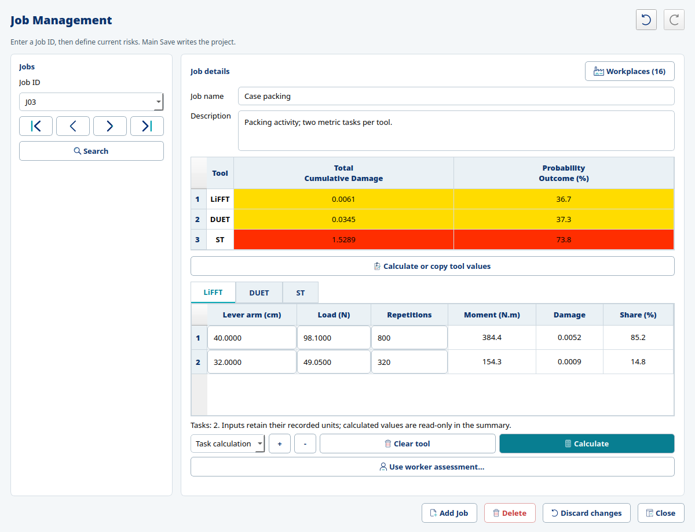

<div align="center">
  

# ErgoTools · PLOT · JROT

**From task exposure and individual assessments to plant-layout analysis and job rotation**

[](docs/installation.md)
[](#ergotools)
[](#overview)
[](LICENSE.txt)
</div>

## Contents

[Overview](#overview) · [Workflow](#workflow) · [ErgoTools](#ergotools) ·
[PLOT](#plot) · [JROT](#jrot) · [Scientific basis](#scientific-basis) ·
[Installation](#installation) · [Projects and saving](#projects-and-saving) ·
[Publications and conferences](#publications-and-conferences) ·
[Documentation](#documentation) · [Repository structure](#repository-structure) ·
[Contributing](#contributing) · [License](#license)

## Overview

ErgoTools integrates three fatigue failure-based ergonomic assessment methods in one
desktop application: **LiFFT**, **DUET**, and the **Shoulder Tool (ST)**. Assess workers
independently, add workplace context when needed, map results with **PLOT**, and use
Job-level risk values to compare rotation schedules with **JROT**.

| ErgoTools | PLOT — Plant-Layout Organizational Tool | JROT — Job Rotation Optimization Tool |
| --- | --- | --- |
| Enter task exposures, calculate cumulative damage and outcome probability, and inspect the anatomical region in 3D. | Explore Individual, Job and Comparison risk views on a plant layout, with workplace and demographic filters. | Build worker-by-time-block schedules, optimize using one tool or all three, and compare current and proposed rotations. |

English and Spanish interfaces, metric and imperial display, searchable worker records,
shared Undo/Redo, and one project Save connect the three workspaces.

## Workflow

1. **Create or open a project and add workers.** Start with standalone assessments;
   organization data is optional.
2. **Enter task data and calculate.** Use LiFFT, DUET or ST for the selected worker.
   Blank unused rows do not make an otherwise complete assessment incomplete.
3. **Add workplace context when useful.** Define Plant → Section → Line → Station and
   recurring shifts, then assign workers. A Job is optional for a workplace assignment.
4. **Analyze the workplace.** Associate an existing standalone assessment with an
   assignment or create an independent assessment for that context. Explore PLOT.
5. **Evaluate rotations.** Define Job risks and use JROT with all active Jobs/workers
   or a selected workplace scope. Review results before applying a proposed schedule.

Use the main **Save** to store accepted edits from assessments and management/analysis
windows together. Closing an editor retains valid changes in the open project session.

## ErgoTools

The assessment workspace combines worker selection, a live **VTK 3D avatar**, task
inputs, per-task damage contributions, and the individual outcome summary. Select an
anatomical region or a tool tab to move between models; rotate, zoom, or reset the body
view. The screenshot shows a calculated standalone LiFFT assessment.


### Three assessment tools, one workspace

| Tool | Region | Task inputs | Outputs |
| --- | --- | --- | --- |
| **LiFFT** — Lifting Fatigue Failure Tool | Low back | Horizontal lever arm, load, repetitions | Moment, task/cumulative damage, contribution and probability of a high-risk job |
| **DUET** — Distal Upper Extremity Tool | Distal upper extremity | OMNI-RES exertion rating, repetitions | Task/cumulative damage, contribution and outcome probability |
| **Shoulder Tool (ST)** | Shoulder | Task type, lever arm, load, repetitions | Moment, task/cumulative damage, contribution and outcome probability |

Task counts are independent for each worker, tool and assessment context: **15 rows
by default, up to 100**. Expanding preserves entered rows; reducing removes the
truncated rows and can be undone. **Clear assessment** resets the active assessment.
Gauge tick spacing and range-limit labels are configurable application preferences.

<details>
<summary><strong>View DUET and Shoulder Tool workspaces</strong></summary>

<table>
<tr>
<td width="50%"><a href="docs/images/ergotools_duet.png"></a></td>
<td width="50%"><a href="docs/images/ergotools_shoulder.png"></a></td>
</tr>
<tr><td><strong>DUET</strong> — exertion and repetition inputs.</td><td><strong>Shoulder Tool</strong> — task type, force and lever-arm inputs.</td></tr>
</table>

</details>

### Workers and workplace context

<table>
<tr>
<td width="54%"><a href="docs/images/worker_management.png"></a></td>
<td width="46%"><a href="docs/images/organization_management.png"></a></td>
</tr>
<tr>
<td valign="top"><strong>Worker Management</strong><br>Searchable identity records, optional demographics and workplace assignments. Each workplace can have an optional Job.</td>
<td valign="top"><strong>Organization Management</strong><br>Plants, sections, lines, stations and recurring shifts. Dates use calendars; shift times use 24-hour input and allow overnight shifts.</td>
</tr>
</table>

A **Station** is a physical location; a **Job** is an activity that can be placed at
one or more workplaces. A worker can have one standalone assessment per tool and
separate assessments for distinct workplace assignments. **Follow worker** and
**Keep context** support browsing these records without conflating them.

## PLOT

PLOT brings saved assessment results and Job risks onto a plant-layout image. Select
a tool, a plant, workplace branches and a shift, then apply the filters. The plant
view supports marker positioning, zoom, fit, opacity, capture and export.


### Individual, Job and Comparison views

<table>
<tr>
<td width="33%"><a href="docs/images/plot_individual_detail.png"></a></td>
<td width="33%"><a href="docs/images/plot_job_detail.png"></a></td>
<td width="34%"><a href="docs/images/plot_comparison_detail.png"></a></td>
</tr>
<tr>
<td valign="top"><strong>Individual</strong><br>Worker assessment symbols colored by outcome probability.</td>
<td valign="top"><strong>Job</strong><br>Job risk displayed at positioned stations.</td>
<td valign="top"><strong>Comparison</strong><br>Worker symbols over Job-risk squares, with separate individual and Job summaries.</td>
</tr>
</table>

Circles, triangles and hexagons distinguish the recorded sex or missing sex; the
legend explains each symbol. A blue frame identifies the selected result. Worker
Overview connects that result to its worker, exact assignment and outcome; Job
Overview provides the corresponding Job information.

<table>
<tr>
<td width="47%"><a href="docs/images/plot_worker_panel.png"></a></td>
<td width="53%"><a href="docs/images/plot_comparison_gauges.png"></a><p><strong>Compare results in context.</strong> Inspect the selected worker, locate its symbol, and compare individual assessment outcomes with applicable Job risks. The gauges summarize the active population; they do not replace individual assessments.</p></td>
</tr>
</table>

### Filters and population summaries

Choose one or more sections, lines or stations inside a plant. Optional demographics
further filter workers by sex, age, weight and height. Paired numeric limits are
inclusive; missing values required by an active filter are excluded.


Tools Overview compares mean outcome probabilities by tool, sex or age group.
Error bars show one standard deviation. Graph Settings controls presentation and
figure export; high-risk station details support closer inspection.

<details>
<summary><strong>View the three population charts</strong></summary>

<table>
<tr>
<td width="33%"></td>
<td width="33%"></td>
<td width="34%"></td>
</tr>
</table>

</details>

## JROT

JROT builds and evaluates worker-by-time-block Job schedules. Use **All Jobs** for
organization-wide planning, or **Workplace** to select station/shift scope with
eligible Job placements and worker assignments. Enter the current rotation, inspect
its risk distribution, then run **Optimize Tool** or **Optimize All Tools**.


**Optimize Tool** uses CBC to minimize the maximum worker average for the selected
method. **Optimize All Tools** uses HiGHS to optimize the three tools together,
then compare their distributions. Review the proposed grid and comparison before
choosing **Use as Current** or applying the all-tool result. Main Save stores the
accepted rotation with the project.

<table>
<tr>
<td width="46%"><a href="docs/images/job_management.png"></a></td>
<td width="54%"><a href="docs/images/jrot_comparison.png"></a></td>
</tr>
<tr>
<td valign="top"><strong>Job risk values</strong><br>One current set per Job/tool: enter known values, calculate from tasks, or copy a worker assessment's inputs and results as an independent Job source.</td>
<td valign="top"><strong>Compare before applying</strong><br>Review current and optimized schedules for LiFFT, DUET and ST using the comparison tabs.</td>
</tr>
</table>

<details>
<summary><strong>View the compact Job calculators</strong></summary>



</details>

Rotation estimates use Job-level measurements and equal time blocks. Interpret the
results alongside Job redesign and other ergonomic controls: redistributing exposure
does not eliminate a hazardous activity.

## Scientific basis

The methods use fatigue failure principles to estimate cumulative loading. Their
anatomical targets and outcome definitions differ; cumulative damage and model-derived
outcome probability are related outputs, not interchangeable quantities.

| Method | Foundational research |
| --- | --- |
| LiFFT | Gallagher et al. (2017). [doi:10.1016/j.apergo.2017.04.016](https://doi.org/10.1016/j.apergo.2017.04.016) |
| DUET | Gallagher et al. (2018). [doi:10.1177/0018720818789319](https://doi.org/10.1177/0018720818789319) |
| Shoulder Tool | Bani Hani et al. (2021). [doi:10.1080/00140139.2020.1811399](https://doi.org/10.1080/00140139.2020.1811399) |

## Installation

| Platform | Status | Start here |
| --- | --- | --- |
| **Linux x86-64** | Native desktop, VTK, CBC and HiGHS verified on Ubuntu 25.04 | [Linux installation](docs/installation.md#linux) |
| **Windows 10/11 x64** | Pinned trial setup; native testing pending | [Windows installation and desktop shortcut](docs/installation.md#windows-trial) |
| **macOS 11+ Intel / Apple silicon** | Pinned trial setup; native testing pending | [macOS installation and desktop alias](docs/installation.md#macos-trial) |

Requirements: **Python 3.13.14**, a graphical desktop with OpenGL, and the exact
runtime versions documented in the [installation guide](docs/installation.md).
The Linux baseline is locked in [`uv.lock`](uv.lock). Windows/macOS use a separate
[pinned trial file](tools/requirements_desktop_trial.txt); Windows uses the approved
Qt 5.15.2 runtime because Qt 5.15.17 has no Windows wheel. No native Windows/macOS
success is claimed from Linux tests or package resolution.

<details>
<summary><strong>Quick start on Linux</strong></summary>

Install Git and uv 0.11.25 using the [setup guide](docs/installation.md#get-git-and-uv), then:

```bash
git clone --branch main --single-branch https://github.com/mhenriquezschott/ErgoTools.git
cd ErgoTools
uv python install 3.13.14
uv sync --locked --no-dev --extra desktop --python 3.13.14
bash tools/run.sh
```

</details>

After setup, launch with `bash tools/run.sh` on Linux, `tools\run_windows.cmd` on
Windows, or `tools/run_macos.command` on macOS. The guide explains desktop shortcuts
and aliases, opening a project directly, and updating with `git pull --ff-only`.
Launchers do not install or update anything automatically.

## Projects and saving

Current `.ergprj` files are self-contained native projects containing organization,
workers, assignments, task inputs, calculated results, embedded plant images, map
positions and saved rotations. No companion project folder is required. Opening an
older format uses the optional [external conversion utility](tools/project_migration/README.md).

The **main Save** stores accepted changes across the application. Shared Undo/Redo
works during the open project session; history is not a substitute for saving or
backups and is not restored on reopening. Use Save As for a personal example copy,
and keep your projects outside the source checkout.

Example datasets are in [`test_projects/native/`](test_projects/native/README.md).
`comparative_risk_test.ergprj` includes populated assessments, a plant layout and
rotations; `jrot_workflow_demo.ergprj` has six fictional workers, six calculated Jobs
and a realistic organization. It has no worker assessments or saved rotations, so
an empty individual grid there is expected. Screenshots above use disposable demo
copies; illustrative values are not recommendations for actual work.

## Publications and conferences

### Publications

1. **Henriquez-Schott, M., Zabala, M., Sesek, R., Gallagher, S., & Nail-Ulloa, I. (2025).** PLOT: A Plant-Layout Organizational Tool Software Based on Fatigue Failure Theory for MSD Control and Mitigation. *Proceedings of the Human Factors and Ergonomics Society Annual Meeting, 69*(1), 625–632. [doi:10.1177/10711813251357881](https://doi.org/10.1177/10711813251357881)
2. **Henriquez-Schott, M., Zabala, M., Gallagher, S., Kotowski, S., Jorgensen, M., Davis, K., & Nail-Ulloa, I. (2025).** ErgoTools: Software Platform Integrating Fatigue Failure-Based Risk Assessment Tools for Ergonomics Evaluation in Salmon Processing. *Ergonomics in Design*. OnlineFirst. [doi:10.1177/10648046251408207](https://doi.org/10.1177/10648046251408207)
3. **Henríquez-Schott, M., Zabala, M., Mercado-Gallardo, V., Vásquez-Castillo, G., Gallagher, S., & Nail-Ulloa, I. (2025).** Integración de herramientas basadas en falla por fatiga para la evaluación ergonómica y productiva en la industria salmonera chilena: desarrollo de software y casos de estudio. *Ergonomía, Investigación y Desarrollo, 7*(2), 11–30. [doi:10.29393/EID7-11IHMI60011](https://doi.org/10.29393/EID7-11IHMI60011)

### Conference presentations

| Year and dates | Presentation | Event and location | Program |
| --- | --- | --- | --- |
| **2025** · October 12–17 | **PLOT: A Plant-Layout Organizational Tool Based on Fatigue Failure Theory for MSD Control and Mitigation** | HFES 69th International Annual Meeting (ASPIRE 2025), Chicago, Illinois, USA. Presented October 15 in the *Effort and Fatigue* session. | [Official presentation record](https://hfesam2025.conference-program.com/presentation/?id=LECT420&sess=sess241) |
| **2025** | ErgoTools/PLOT research dissemination at the Applied Human Factors and Ergonomics International Conference | Applied Human Factors and Ergonomics (AHFE 2025) | [Official AHFE 2025 program](https://www.ahfe.org/files/AHFE2025_FinalProgram.pdf) |
| **2024** · September 9–13 | **Fatigue Failure Risk Assessment Tool: A Software for Integrated Approach to Ergonomic Analysis** | ASPIRE 2024 International Annual Meeting, Phoenix, Arizona, USA | [Event information](https://iea.cc/event/aspire-the-hfes-international-annual-meeting/) |

The AHFE 2025 association is recorded by the project team; its exact presentation
title, date, location and direct program entry remain to be documented.

### Citing the software

Cite the **PLOT paper** for plant-layout analysis, the **ErgoTools platform paper** or
Spanish case-study paper for the integrated application, and the foundational method
papers when reporting LiFFT, DUET or ST results. A versioned software DOI and preferred
software citation have not yet been published.

## Documentation

| For users | For developers |
| --- | --- |
| [Installation and desktop launchers](docs/installation.md) | [Development and verification](docs/development.md) |
| [English user guide](docs/user_guide.md) · [Guía en español](docs/user_guide_es.md) | [Architecture](docs/architecture.md) · [Coding standards](docs/coding_standards.md) |
| [Backup and recovery](docs/recovery.md) | [API contracts](docs/api_contracts.md) · [Database reference](docs/database_tables.md) |
| [Native example projects](test_projects/native/README.md) | [Current validation and status](docs/STATUS.md) · [Platform review](docs/platform_review.md) |

## Repository structure

| Path | Purpose |
| --- | --- |
| `src/ergotools/domain/` | Assessment models, units, validation and scientific calculations |
| `src/ergotools/application/` | Project, assessment, PLOT and rotation use cases and ports |
| `src/ergotools/infrastructure/` | Native storage, settings, resources and CBC/HiGHS adapters |
| `src/ergotools/presentation/` | Qt interfaces, charts, shared controls and isolated VTK rendering |
| `src/ergotools/resources/` | Packaged icons, logo, anatomical models and bilingual Help |
| `tests/` | Scientific, persistence, workflow, UI and architecture regressions |
| `test_projects/native/` | Current self-contained demonstration and test projects |
| `test_projects/originals/` | Frozen original-format conversion fixtures |
| `tools/` | Launchers, verification, packaging and optional project conversion |
| `docs/` | User/developer guides, scientific contracts, validation and screenshots |
| `pyproject.toml` · `uv.lock` | Package metadata and the exact approved dependency baseline |

## Contributing

Use focused changes that preserve calculations, project integrity and established
workflows. Read the architecture and coding standards, document changed contracts,
and run `bash tools/check.sh` in the approved development environment. UI changes
also need inspection of populated, empty, selected, expanded and collapsed states,
including the avatar, result panels and bottom controls.

Dependency changes require project-owner approval. Bug reports should include
reproduction steps, OS/architecture and a screenshot or de-identified example project.
Use synthetic or anonymized worker data in public contributions.

## License

ErgoTools is distributed under the [Apache License 2.0](LICENSE.txt).
See [NOTICE](NOTICE) for authorship notices and
[third-party notices](THIRD_PARTY_NOTICES.txt) for included dependency information.
Dependencies retain their respective licenses.
