<div align="center">
  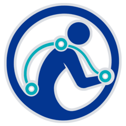

# ErgoTools · PLOT · JROT

**From task exposure and individual assessments to plant-layout analysis and job rotation**

[](docs/installation.md)
[](#ergotools)
[](#overview)
[](LICENSE.txt)
</div>

## Contents

- [Overview](#overview)
- [ErgoTools](#ergotools)
- [PLOT](#plot)
- [JROT](#jrot)
- [Scientific basis](#scientific-basis)
- [Installation](#installation)
- [Publications and conferences](#publications-and-conferences)
- [Documentation](#documentation)
- [Repository structure](#repository-structure)
- [Contributing](#contributing)
- [License](#license)

## Overview

ErgoTools is a desktop platform for fatigue failure-based ergonomic assessment,
plant-layout risk visualization and job rotation optimization. It integrates
**LiFFT**, **DUET** and the **Shoulder Tool (ST)** with two complementary analysis
workspaces: **PLOT** and **JROT**.

| ErgoTools | PLOT — Plant-Layout Organizational Tool | JROT — Job Rotation Optimization Tool |
| --- | --- | --- |
| Assess task exposures, cumulative damage and model-derived risk for the low back, distal upper extremity and shoulder. | Explore worker and Job risks across a plant layout, with population summaries and workplace filters. | Evaluate Job rotation schedules and compare optimized distributions of worker exposure. |

The application supports English and Spanish, metric and imperial units, worker
and organization management, and interactive 3D anatomical visualization.

## ErgoTools

Three assessment methods share a workspace with task inputs, calculated damage
contributions, a 3D anatomical view and a risk summary.

### LiFFT — Lifting Fatigue Failure Tool

Low-back assessment based on load, horizontal lever arm and repetitions. Results
include lifting moment, task and cumulative damage, and probability of a high-risk Job.

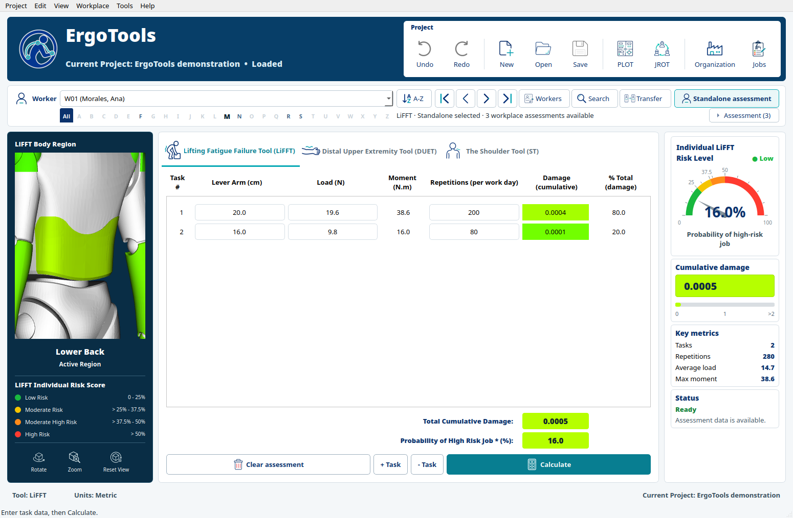

### DUET — Distal Upper Extremity Tool

Distal upper-extremity assessment based on exertion intensity and repetitions.
The task table presents each activity's contribution to cumulative damage alongside
the overall model-derived outcome probability.

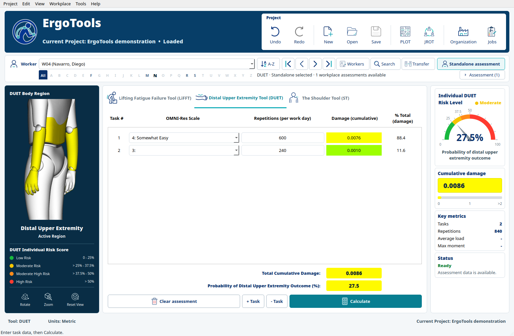

### ST — Shoulder Tool

Shoulder assessment incorporating task type, lever arm, load and repetitions.
The anatomical view highlights the assessed region, while task contributions and
the overall summary describe the modeled exposure.

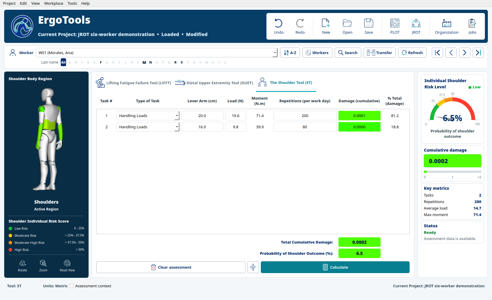

### Anatomy and risk summary

<table>
<tr>
<td width="42%" align="center">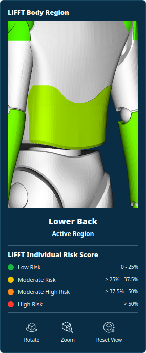</td>
<td width="58%" align="center">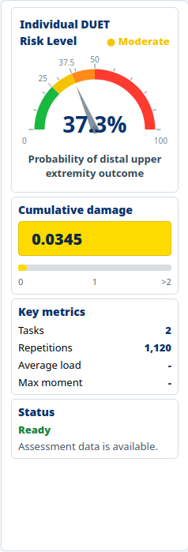</td>
</tr>
<tr>
<td valign="top"><strong>Anatomical context.</strong> The interactive 3D avatar identifies the region assessed by each method. The accompanying legend relates colors to the risk categories.</td>
<td valign="top"><strong>Results at a glance.</strong> The gauge locates the calculated probability within the risk ranges. Cumulative damage and key metrics complement the probability result; the task table identifies individual damage contributions.</td>
</tr>
</table>

### Workers and organization

<table>
<tr>
<td width="54%"><a href="docs/images/worker_management.png">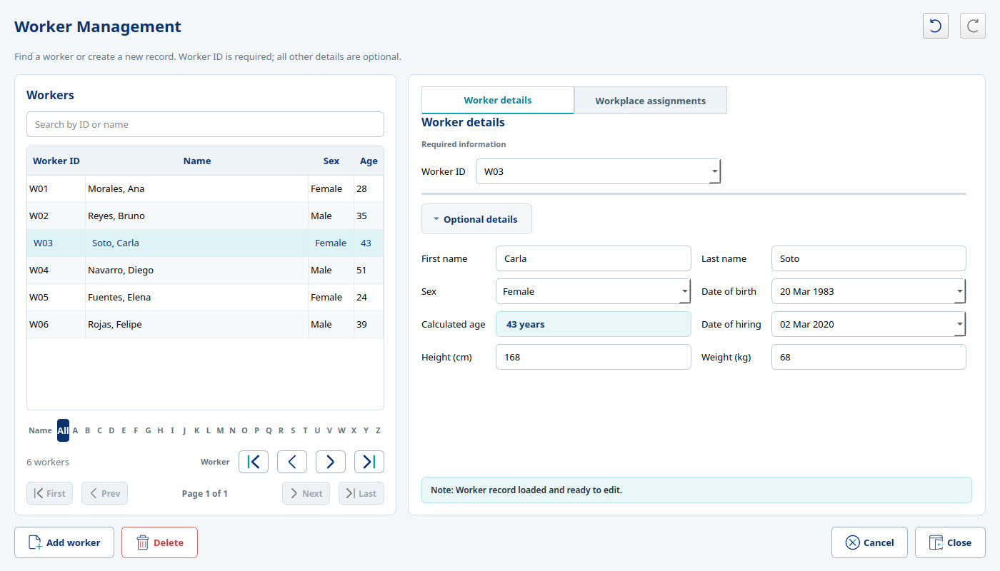</a></td>
<td width="46%"><a href="docs/images/organization_management.png">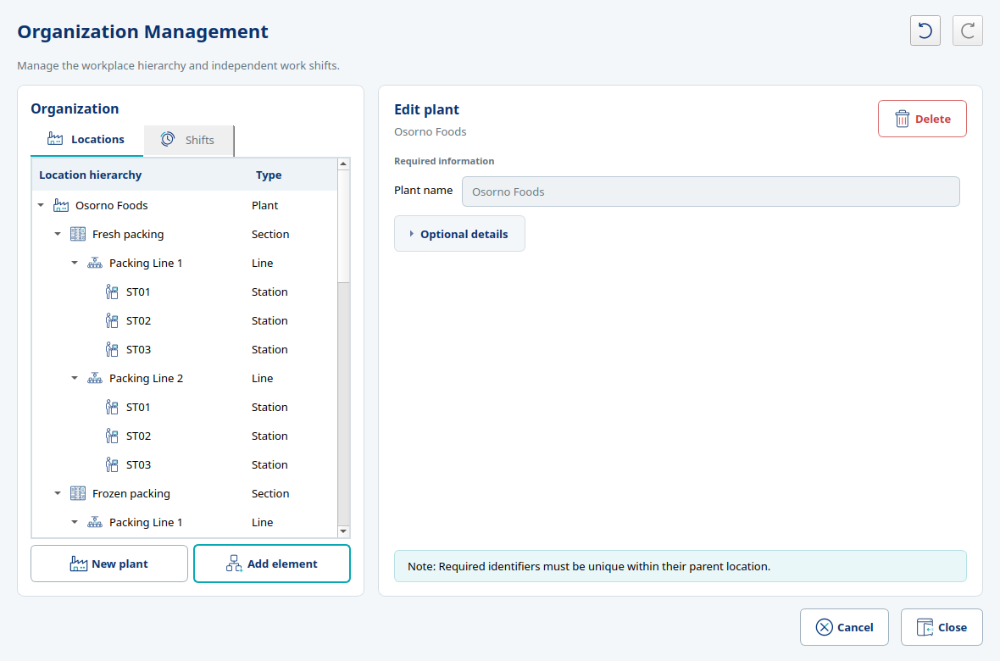</a></td>
</tr>
<tr>
<td valign="top"><strong>Worker records.</strong> Identity, demographic information and workplace assignments provide context for individual and population assessments.</td>
<td valign="top"><strong>Organization structure.</strong> Plants, sections, lines, stations and shifts describe the workplace. A Station is a physical location; a Job is an activity performed there.</td>
</tr>
</table>

## PLOT

PLOT maps ergonomic assessment results onto a plant layout, connecting risk values
with the physical workplace and the people working there.

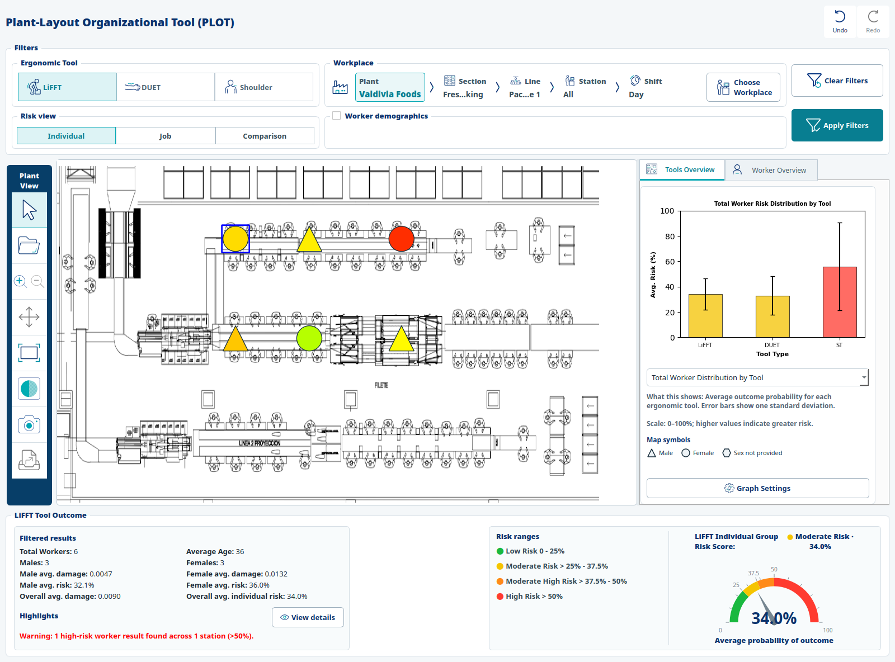

### Workplace and demographic filters

Workplace filters focus the analysis on a plant, section, line, station or shift.
Demographic filters refine the worker population by sex, age, weight and height.

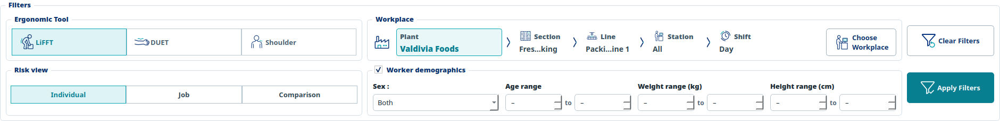

### Individual risk

Worker markers show individual assessment outcomes at their workplace locations.
Marker colors express risk, while shapes distinguish recorded sex categories.
The Worker Overview panel describes the selected worker and assessment.

<table>
<tr>
<td width="45%">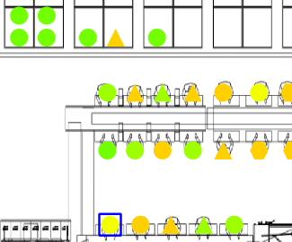<p>Individual assessment results mapped to workplace locations.</p>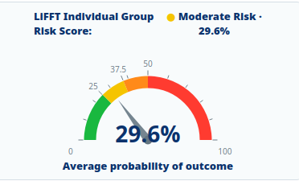<p>The individual summary represents the filtered worker population.</p></td>
<td width="55%" align="center">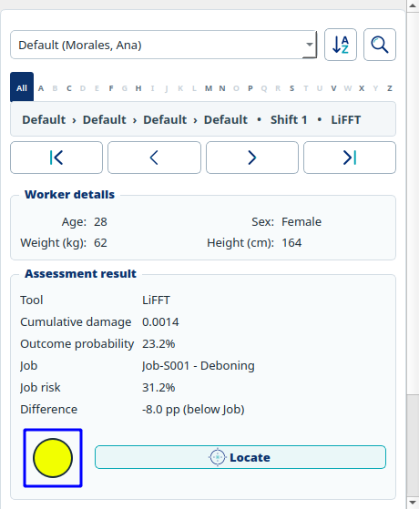</td>
</tr>
</table>

### Job risk

The Job view displays activity-level risk at stations, independently of a particular
worker's assessment. Job information and the Job summary provide an overview of the
activities included in the analysis.

<table>
<tr>
<td width="50%">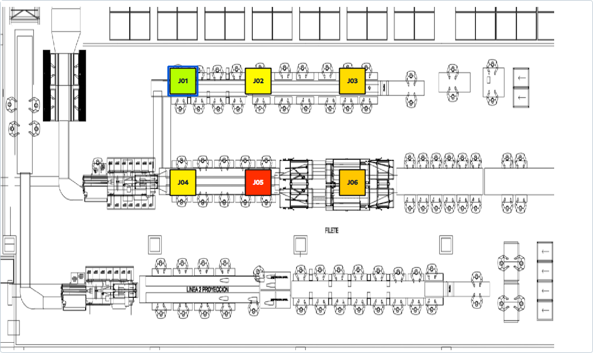</td>
<td width="50%">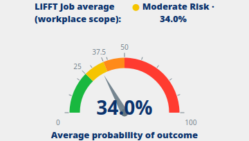</td>
</tr>
<tr><td>Job risk colors at workplace locations.</td><td>Summary of the applicable Job risks.</td></tr>
</table>

### Comparison

The comparison view overlays worker symbols on Job-risk squares. Separate gauges
summarize the individual assessment results and applicable Job risks, making the
two sources visible together while preserving their different meanings.

<table>
<tr>
<td width="38%">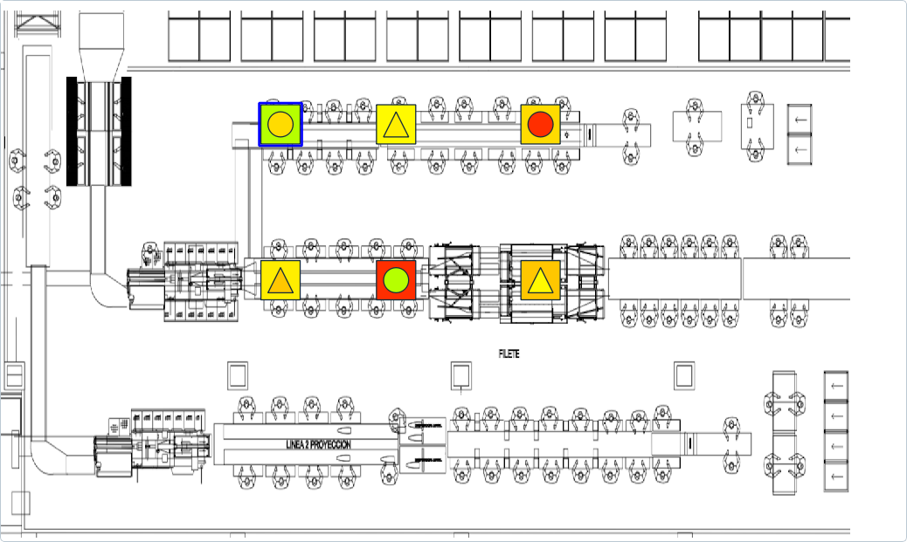</td>
<td width="62%">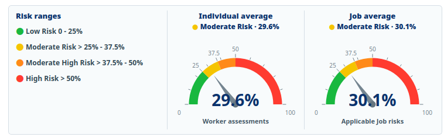</td>
</tr>
</table>

### Population charts

Tools Overview summarizes the filtered worker population in three complementary
charts. Bars represent mean model-derived outcome probabilities; error bars show
one standard deviation.

<table>
<tr>
<td width="33%">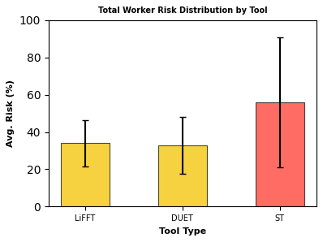</td>
<td width="33%">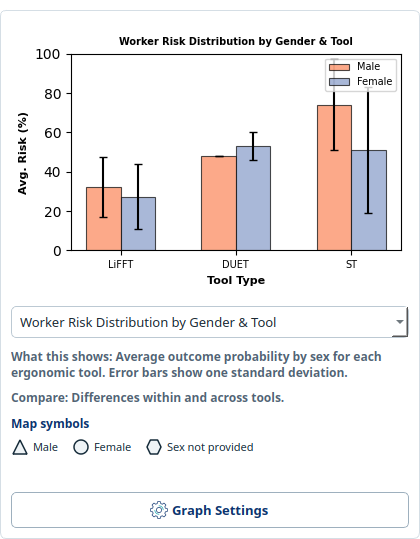</td>
<td width="34%">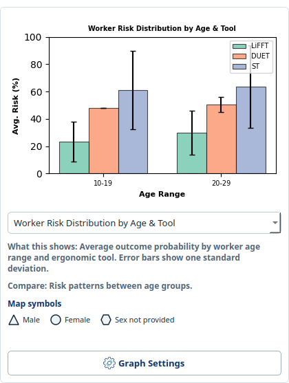</td>
</tr>
<tr>
<td valign="top"><strong>By tool.</strong> Compare the population's results across LiFFT, DUET and ST.</td>
<td valign="top"><strong>By sex.</strong> Compare the recorded sex groups within each assessment method.</td>
<td valign="top"><strong>By age.</strong> Compare age groups to examine how exposure is distributed across the workforce.</td>
</tr>
</table>

## JROT

JROT evaluates worker-by-time-block Job schedules and optimizes the distribution
of exposure. Analyses can cover all Jobs or a selected workplace scope, using
one assessment method or LiFFT, DUET and ST together.

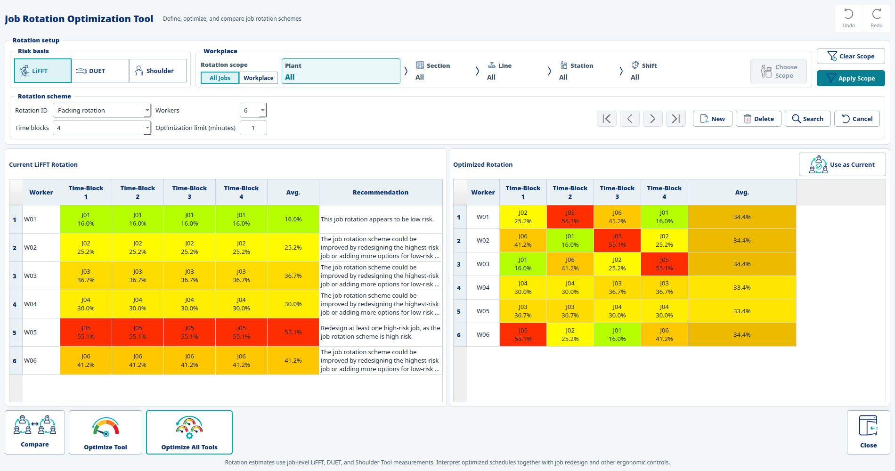

Job risks can come from existing measurements, task-based calculations or copied
worker assessments. Single-tool optimization uses CBC; combined optimization uses
HiGHS. Comparison views present the current and proposed schedules and their exposure
distributions.

<table>
<tr>
<td width="46%"><a href="docs/images/job_management.png">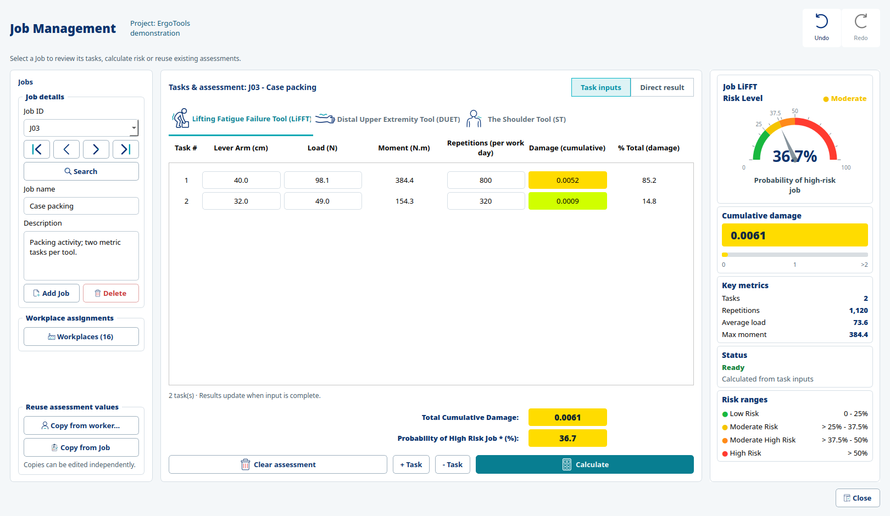</a></td>
<td width="54%"><a href="docs/images/jrot_comparison.png">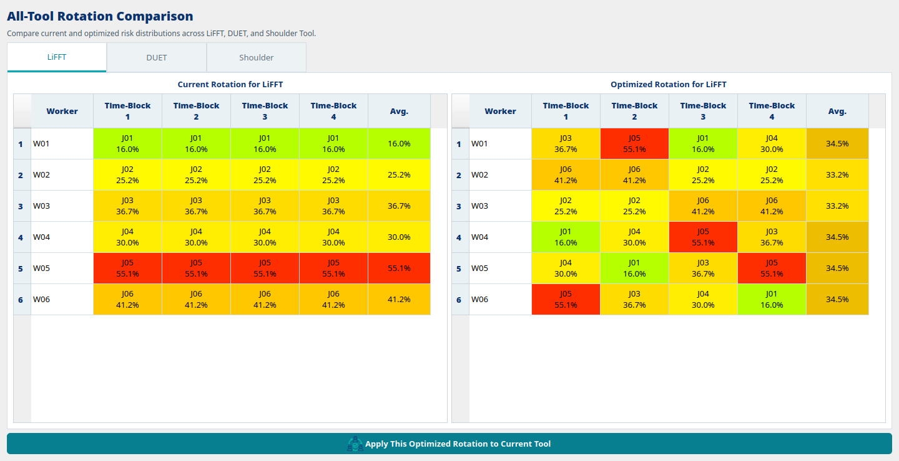</a></td>
</tr>
<tr>
<td valign="top"><strong>Job assessment.</strong> Activity-level measurements supply the ergonomic basis for rotation analysis.</td>
<td valign="top"><strong>Rotation comparison.</strong> Current and optimized schedules reveal changes in the distribution of worker exposure.</td>
</tr>
</table>

Rotation analysis complements Job redesign and other ergonomic controls.
Redistributing exposure does not eliminate a hazardous activity.

## Scientific basis

The methods use fatigue failure principles to estimate cumulative loading. Their
anatomical targets and outcome definitions differ; cumulative damage and model-derived
outcome probability are related outputs, not interchangeable quantities.

| Method | Foundational research |
| --- | --- |
| LiFFT | Gallagher et al. (2017). [doi:10.1016/j.apergo.2017.04.016](https://doi.org/10.1016/j.apergo.2017.04.016) |
| DUET | Gallagher et al. (2018). [doi:10.1177/0018720818789319](https://doi.org/10.1177/0018720818789319) |
| Shoulder Tool | Bani Hani et al. (2021). [doi:10.1080/00140139.2020.1811399](https://doi.org/10.1080/00140139.2020.1811399) |

## Installation

A graphical desktop with OpenGL, **Python 3.13.14** and Git are required.
The installation guide includes dependencies, setup commands and desktop shortcuts
for each platform.

| Platform | Requirements | Installation |
| --- | --- | --- |
| **Linux x86-64** | Qt/XCB and OpenGL system libraries; Qt 5.15.17 | [Linux setup](docs/installation.md#linux) |
| **Windows 10/11 x64** | OpenGL-capable graphics driver; Qt 5.15.2 | [Windows setup and desktop shortcut](docs/installation.md#windows-trial) |
| **macOS 11+ Intel / Apple silicon** | Matching Python architecture; Qt 5.15.17 | [macOS setup and desktop alias](docs/installation.md#macos-trial) |

Windows uses Qt 5.15.2 because Qt 5.15.17 has no Windows wheel.

**Linux quick start**, with [Git and uv installed](docs/installation.md#get-git-and-uv):

```bash
git clone --branch main --single-branch https://github.com/mhenriquezschott/ErgoTools.git
cd ErgoTools
uv python install 3.13.14
uv sync --locked --no-dev --extra desktop --python 3.13.14
bash tools/run.sh
```

Launch scripts: `tools/run.sh` for Linux, `tools\run_windows.cmd` for Windows,
and `tools/run_macos.command` for macOS.

## Publications and conferences

### Publications

1. **Henriquez-Schott, M., Zabala, M., Sesek, R., Gallagher, S., & Nail-Ulloa, I. (2025).** PLOT: A Plant-Layout Organizational Tool Software Based on Fatigue Failure Theory for MSD Control and Mitigation. *Proceedings of the Human Factors and Ergonomics Society Annual Meeting, 69*(1), 625–632. [doi:10.1177/10711813251357881](https://doi.org/10.1177/10711813251357881)
2. **Henriquez-Schott, M., Zabala, M., Gallagher, S., Kotowski, S., Jorgensen, M., Davis, K., & Nail-Ulloa, I. (2025).** ErgoTools: Software Platform Integrating Fatigue Failure-Based Risk Assessment Tools for Ergonomics Evaluation in Salmon Processing. *Ergonomics in Design*. OnlineFirst. [doi:10.1177/10648046251408207](https://doi.org/10.1177/10648046251408207)
3. **Henríquez-Schott, M., Zabala, M., Mercado-Gallardo, V., Vásquez-Castillo, G., Gallagher, S., & Nail-Ulloa, I. (2025).** Integración de herramientas basadas en falla por fatiga para la evaluación ergonómica y productiva en la industria salmonera chilena: desarrollo de software y casos de estudio. *Ergonomía, Investigación y Desarrollo, 7*(2), 11–30. [doi:10.29393/EID7-11IHMI60011](https://doi.org/10.29393/EID7-11IHMI60011)

### Conference presentations

| Year and dates | Presentation | Event and location | Program |
| --- | --- | --- | --- |
| **2025** · October 12–17 | **PLOT: A Plant-Layout Organizational Tool Based on Fatigue Failure Theory for MSD Control and Mitigation** | HFES 69th International Annual Meeting (ASPIRE 2025), Chicago, Illinois, USA. Presented October 15 in the *Effort and Fatigue* session. | [Official presentation record](https://hfesam2025.conference-program.com/presentation/?id=LECT420&sess=sess241) |
| **2025** | ErgoTools/PLOT research dissemination at the Applied Human Factors and Ergonomics International Conference | Applied Human Factors and Ergonomics (AHFE 2025) | [Official AHFE 2025 program](https://www.ahfe.org/files/AHFE2025_FinalProgram.pdf) |
| **2024** · September 9–13 | **Fatigue Failure Risk Assessment Tool: A Software for Integrated Approach to Ergonomic Analysis** | ASPIRE 2024 International Annual Meeting, Phoenix, Arizona, USA | [Event information](https://iea.cc/event/aspire-the-hfes-international-annual-meeting/) |

The AHFE 2025 association is recorded by the project team; its exact presentation
title, date, location and direct program entry remain to be documented.

### Citing the software

Cite the **PLOT paper** for plant-layout analysis, the **ErgoTools platform paper** or
Spanish case-study paper for the integrated application, and the foundational method
papers when reporting LiFFT, DUET or ST results. A versioned software DOI and preferred
software citation have not yet been published.

## Documentation

| Users | Developers |
| --- | --- |
| [Installation and desktop launchers](docs/installation.md) | [Development](docs/development.md) |
| [English user guide](docs/user_guide.md) · [Guía en español](docs/user_guide_es.md) | [Architecture](docs/architecture.md) · [Coding standards](docs/coding_standards.md) |
| [Backup and recovery](docs/recovery.md) | [API contracts](docs/api_contracts.md) · [Database reference](docs/database_tables.md) |
| [Example projects](test_projects/native/README.md) | [Scientific calculations](#scientific-basis) |

## Repository structure

| Path | Purpose |
| --- | --- |
| `src/ergotools/domain/` | Scientific calculations, assessment models, units and validation |
| `src/ergotools/application/` | Assessment, project, PLOT and rotation services |
| `src/ergotools/infrastructure/` | Storage, settings and solver adapters |
| `src/ergotools/presentation/` | Desktop interfaces, charts and 3D rendering |
| `src/ergotools/resources/` | Anatomical models, icons and bilingual Help |
| `tests/` | Calculation, storage, interface and integration tests |
| `test_projects/` | Example projects and conversion test datasets |
| `tools/` | Launchers, development checks and conversion utilities |
| `docs/` | User guides, technical documentation and screenshots |

## Contributing

Bug reports should include the operating system, reproduction steps and, where
helpful, a screenshot or anonymized example project. For code contributions, consult
the architecture and coding standards and run `bash tools/check.sh`.

## License

ErgoTools is distributed under the [Apache License 2.0](LICENSE.txt).
See [NOTICE](NOTICE) for authorship notices and
[third-party notices](THIRD_PARTY_NOTICES.txt) for included dependency information.
Dependencies retain their respective licenses.
