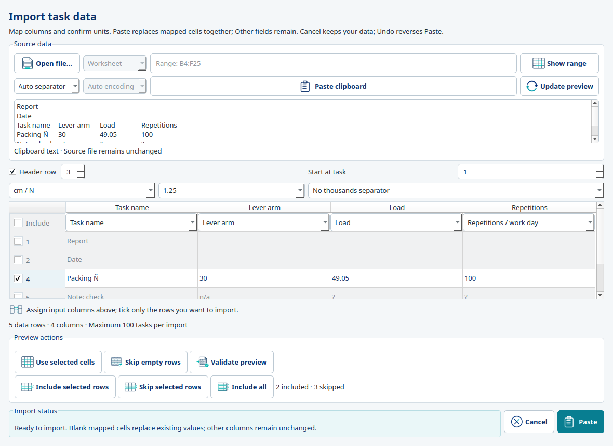

# Import and paste assessment inputs

Worker assessments, Job Management and guided JROT share the same import controls for
LiFFT, DUET and ST. The small import/settings button beside Paste always opens the
preview. Paste (or Ctrl+V on a rectangular selection) uses the last compatible per-tool
mapping; a new or incompatible source opens the preview for review. Ordinary single-cell
text editing keeps native paste behavior.

## Select and interpret data

Paste a rectangular selection from Excel or another spreadsheet, stage delimited text,
or choose **Open file…** for `.csv`, `.tsv`, `.txt`, `.xlsx` or `.xlsm`. Excel is not required.
For a workbook, choose its worksheet and an A1 range such as `B4:F25`, then **Show range**.
All sheet names are listed; chart-only sheets cannot supply cells. The initial workbook
preview covers at most 101 rows and 20 columns; select an explicit range for data farther
away. Text-file previews cover up to 2,000 rows and 100 columns; explicit ranges may
also select rows beyond that preview. Files are limited to 32 MB; text is additionally
bounded to four million characters. Destination assessments retain their 100-task limit.

Select tab, comma, semicolon, pipe, automatic detection or one custom separator. Text
files offer automatic Unicode detection, UTF-8, UTF-16, Windows-1252, ISO-8859-1 and
ISO-8859-15. Auto does not guess a legacy encoding: choose one explicitly when requested.
Clipboard and workbook strings are already Unicode. Accents and ñ are preserved.

Check **Header row** and choose its source row number. Rows before that header are
skipped automatically but remain visible. Choose each source column's target (or Ignore),
starting task, units, decimal separator and optional thousands separator. Each input may
be mapped only once. Derived results and task IDs are not import destinations. Load is
force in N or lbf, not mass in kg; incompatible unit headers are rejected. The existing
input rules validate numbers, repetitions, OMNI-RES and ST direction choices.

The table is temporary and editable. Correct cells there, or select one rectangular
range and choose **Use selected cells**. **Validate preview** checks without importing.
Changing raw text, encoding, separator or range requires Update preview / Show range
before Apply, so older cells cannot silently be imported. A failed file/range read also
blocks the previous preview until a valid source is loaded again.

Use the checkboxes beside source row numbers to include or skip individual rows.
Skipped rows are gray; their staged contents and original row numbers remain visible.
Select cells/row numbers and choose **Include selected rows** or **Skip selected rows**
for a range; Ctrl permits separate ranges. The checkbox beside Include toggles all
preview data rows. **Include all** restores every staged data row without resetting
column mapping. A count shows included/skipped rows; excluded notes or extra headers
do not enter validation or the destination assessment. Including them again revalidates.
Background validation updates highlights and status without moving the preview or
changing its selection. Explicit **Validate preview** or **Paste** reveals the first
invalid row when correction is required.

**Skip empty rows** reversibly skips rows with no values in any mapped input.
Calculated/ignored columns do not make a task. Named or partially entered tasks remain
included; blank fields within a task never shift into other rows. Ordinary fast Paste
keeps its existing rectangular blank-cell semantics. ST “Please select ...” remains an
unset direction. Source row exclusions and the header's numeric position are temporary
source-specific choices, not stored application preferences. Selecting a new source
resets them; no source workbook/text file is edited.

Preview actions are grouped separately from Import status. The status area stays
beside Cancel/Paste, and range/clipboard/update/inclusion actions reuse the existing
application glyphs. Primary Paste uses a light icon; the modal remains compact.

Accepted pastes automatically make mapped, included task names reusable throughout
this project. Existing names are reused; missing names create one catalog entry per
distinct name. Matching ignores outer whitespace, case and Unicode composition while
preserving accents. Explicit existing definition links remain distinct; existing
same-name catalog entries are not merged. Pasted literal fallback text and numeric
inputs retain their precision. Unmapped name columns, skipped rows and unrelated task
rows create no names. Previewing a file, Settings samples and Cancel create nothing.

Input values, reusable names, references and automatic calculations form **one Undo
step**. Undo asks for confirmation, restores previous inputs/results and removes only
the definitions created by that paste. Existing definitions remain. Canceling the
warning leaves everything intact. Redo restores the same definition IDs and complete
paste without creating duplicates. Main Save writes both names and assessment data.
Open task grids refresh reusable choices without accepting unfinished typed names.
Typing an individual local name remains separate from this import policy; **Task names**
and **Workplace → Task names…** still manage the reusable catalog explicitly.

## Apply and remember

Paste applies the complete validated rectangle as one existing project-history action.
An invalid value rejects the whole operation. Input errors identify their row/field;
interpretation errors explain the mapping, units or number-format choice to correct. Started rows
with missing required inputs may be imported and completed later; the preview warns
about them and they do not become complete calculations. Entirely unused rows remain
unused. Blank mapped cells clear their target fields; unmapped fields retain their values.
The grid expands as needed, within 100 tasks. Source precision and task identities follow
the shared input mapper. Existing automatic calculation, Undo/Redo and Main Save apply.
Cancel changes neither the assessment nor import preferences.

After successful acceptance, each tool remembers its mapping, header labels and parsing
choices in personal application preferences. Body cells, source paths, worksheets, row exclusions, header row position and
ranges are never saved there. Changed source headers trigger review rather than silently
reusing a mismatched saved map. A settings-write error after successful import is reported
separately; it does not falsely report that accepted assessment data was lost.

Settings → **Import / paste** embeds the same component. Choose a tool and configure a
sample preview; Apply stores only preferences, never sample assessment values. Cancel
keeps previous preferences. Opening this section without changes creates no profile.
Import-only preference changes do not commit unfinished assessment text.

## Files, formulas and ownership

Sources are opened read-only and closed before detached values reach the UI. No formula
is evaluated, no VBA/macro is run and no workbook is saved. Macro-enabled `.xlsm`
files supply worksheet values through the same read-only path as `.xlsx`. Formula text in a mapped numeric/choice cell fails
normal input validation; ignored columns are not inputs. To use a formula's output, copy
its displayed values from Excel or export values to CSV. Legacy `.xls` is not supported.

`application/assessment_import.py` owns immutable profiles, parsing/normalization and the
existing clipboard mapper boundary. `SpreadsheetValueReader` alone owns file/Excel access.
`AssessmentImportPanel` is reused by the modal wrapper and embedded Settings;
`AssessmentEditorPreferences` binds explicit host-owned grids to personal import and
column preferences.
Hosts retain acceptance, calculation and history. Read-only task-copy grids have no import
controls. No project table, result formula, optimizer objective or constraint is changed.

Runtime additions approved by the owner: **openpyxl 3.1.5** and **et-xmlfile 2.0.0**.
See [installation](installation.md), [shared editor](shared_assessment_editor.md) and
[settings](user_settings.md).
