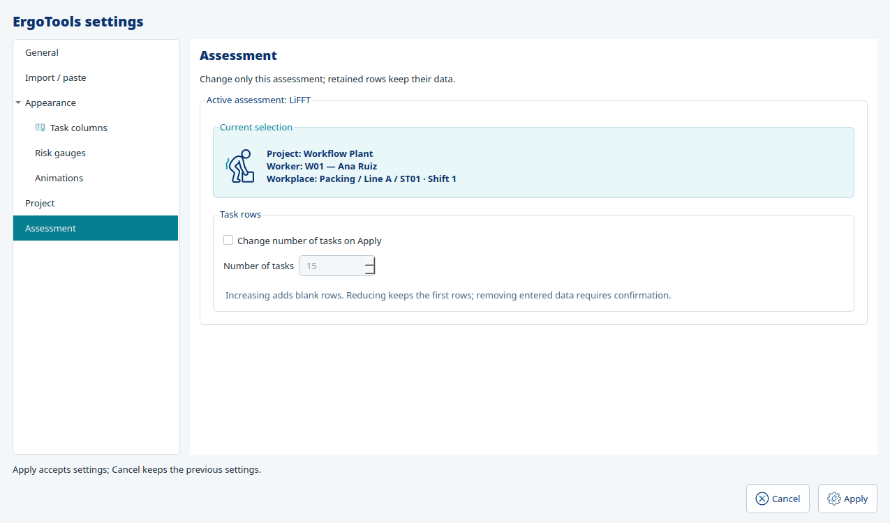

# Application preferences

The historical checkpoint below is retained for provenance. Current Settings uses
section navigation, live task-column/gauge previews, animated avatar/gauge/damage
examples, and current-launch report access. See
[visual Settings and display diagnostics](settings_previews_and_diagnostics.md).

## Optimization runtime

All JROT optimization and feasibility generation use HiGHS directly. No solver-selection
control exists in General or Compatibility/Legacy. Existing results remain unchanged
until a new result is explicitly kept. See [HiGHS-only runtime](highs_only.md).

## Assessment presentation

Assessment shows the active tool and a tinted Current selection card with its tool
icon and literal project, worker and workplace identity. Task rows is a separate group
containing the explicit Apply opt-in, compact row count and data-retention explanation.
The existing 1–100 range, confirmation, Apply/Cancel and scoped Undo behavior are
unchanged. With no active assessment, these controls remain disabled.

## Historical F88 checkpoint

The owner allows improvement of the limited Settings window. Edit > Settings now
opens a styled owned form for independent language and unit choices, with packaged
Cancel/Settings icons and explicit Apply/Cancel. The existing toolbar Settings keeps
its original task-count operation; no source-clearing operation is hidden in the
preferences form. Edit/Editar and Settings/Configuración are localized.

The view collects typed enum selections; it does not access settings or project
storage. `LifftWindow` receives the existing `SettingsStore` through composition.
Cancel does not commit pending text. Apply validates pending input using the current
source units/convention, then saves updated language/default units while preserving
recent locations. Source units and values are retained across display projection.
UserSettings and the JSON format are unchanged. Language never implies units.
Decimal convention remains the existing session preference, not a new persisted field.
Existing blank-version/source-unit policies remain; no scientific conversion policy
or stored project metadata is silently changed.

Invalid input leaves pending text/source/preferences untouched. Settings-write
failure leaves the previous display policy; valid task text accepted during Apply
remains a normal source edit, with the editor rebound so subsequent editing remains
usable. New windows load persisted preferences through bootstrap even with no open
project. Invalid settings files propagate their existing adapter errors instead of
silently overwriting them. Preferences work independently of source availability.

Three parameterized native workflows exercise LiFFT/DUET/ST actual modal Cancel,
invalid Apply, injected settings-write failure, valid input recovery, Apply,
source-unit retention, preserved recent locations and preference restoration in a
fresh window. Required gates pass with 685 tests and 96.85% combined
coverage, strict mypy on 141 source files, lint/format, architecture and both builds.

Native captures under `artifacts/preferences/` cover default/selected dialogs,
expanded language/unit controls, Cancel with pending invalid input, invalid Apply,
Spanish/metric main layouts for all three tools and 1920 by 1200 enlargement.
Minimum layout is 1550 by 1015. Avatar, cards, labels and bottom controls remain
visible. A LiFFT footer mismatch was observed and corrected: footer units identify
the selected display system, not the recorded source system. Native VTK framebuffers
are composed using F78's capture method. Existing metric moment scientific review
and label policies remain outstanding; this is not final metric calculation acceptance.

The isolated wheel passed three-tool actual Settings Cancel/Apply, unchanged
persisted sources, language/unit restoration and native renderer cleanup. All 500
reference hashes and the lock remain unchanged. Evidence is `f88_validation.json`,
`artifacts/f88-check.log` and archived `reference/f88-capture.py.txt` /
`reference/f88-verify.py.txt`. Only synthetic project/preferences paths were used.
No dependency, reference environment or operational project was changed.

Next are remaining project/menu lifecycle operations. Full dialog/Qt-stock language
coverage, decimal preference persistence, scientific decisions and remaining
application modules still require migration; this slice is not full Settings or
whole-application parity.

F94 supersedes the earlier session-only decimal limitation: Settings now includes
persisted decimal convention and user-settings format two. See
[decimal preferences](decimal_preferences.md) for backwards compatibility and tests.
