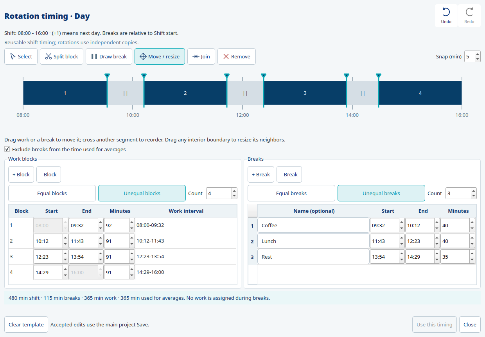

# Rotation work and break segments

Open Organization → Shift → Rotation timing…, or edit a rotation’s independent copy in JROT. Opening alone creates no timing. Use this timing accepts the preview; completed edits share project Undo/Redo and Main Save. Existing interrupted timings remain compatible and are shown as a separated-block preview until explicit acceptance.

Each numbered work block is uninterrupted. Navy means work and grey means a break. Work blocks and Breaks have matching +/−, Equal/Unequal and Count controls, plus 24-hour clocks and minutes. Labels sit beside their count controls. Manual inputs can be edited directly; invalid fields stay available for correction and cannot partially write.

Move/resize works on both work and breaks. Drag an interior segment to slide it while its two neighbors adjust; dragging past neighboring segments reorders whole intervals. Edge segments can be reordered too. The selected segment keeps its duration during movement; borrowing time between differently typed neighbors can change the total work/break budget, which the totals show. Any interior boundary resizes its two neighbors. Shift endpoints remain fixed. Bodies show open/closed hand cursors and boundaries show horizontal resize. Selecting an interior boundary displays its exact clock beneath the marker, including during resize and keyboard adjustment. Split uses scissors, Join inward arrows and Remove a red cross; a white halo keeps these cursors visible over work and breaks. Hover descriptions identify work blocks or named breaks with their start/end clocks and minutes, plus instructions for the active tool. Boundary tooltips explain resizing and arrow-key adjustment. Split/Draw show a snapped vertical clock guide and hover highlights the target. Escape cancels the preview; arrows move a selected boundary and Delete removes the selected segment.

Remove acts on either type. At the beginning/end, the only neighbor absorbs the removed interval. In the middle, each immediate neighbor receives half its minutes; an odd extra minute goes left. A neighbor may be work or a break. Names of retained breaks remain intact. If removing work extends breaks and reduces productive time, confirmation explains that change. The last remaining work block cannot be removed because a rotation requires productive time. Join remains a separate operation: it combines adjacent work blocks or touching breaks without silently deleting an intervening interval.

Equal blocks redistributes the total productive budget; Equal breaks divides the existing total break time among the current pauses, keeping their names. One-minute remainders go to earlier entries. Each action preserves the other type’s total and honors its Equal choice. Changing a count uses the same coordinator and review warning. If no break budget exists, entering a positive count asks for total break minutes. Increasing a count requires at least one minute per interval; impossible budgets are explained instead of deleting data. Reducing break count names the removed definitions before confirmation. Zero breaks explicitly returns their time to work. When there are more breaks than work gaps, pauses may become adjacent; the warning states this instead of forcing extra work blocks. Unequal permits custom editing; accepted data determines the displayed break equality after reload.

Redistribution may shift clocks and is confirmed before acceptance. Names/durations are retained except for the expressly selected break-count reduction or pause-budget change. Each accepted operation is one shared history step. Existing scenario consent also guards assignment cells affected by structural block changes. No Job assignments are inferred by moving time segments.

Exclude breaks chooses productive minutes for averages; leaving it off uses the full shift interval. Neither choice implies recovery or changes intrinsic Job risk. Timings remain relative to Shift start; overnight clocks show (+1). Native24 stores existing durations and break intervals, with no extra break-mode field or schema migration. Both work and pause values persist; break equality is derived from the actual saved durations.

## Shared segment engine

`rotation_segments` owns immutable positive segments, existing-model encoding, kind/ordinal resolution, neighbor-sharing removal, local movement/reordering, boundary resize and coordinated count/equality proposals. Timeline and manual forms use the same complete model and acceptance/history ports. No GUI/storage/solver imports enter this module. `rotation_timing_actions` retains split/draw/clock-cut helpers and delegates uniform removal/equality instead of duplicating rules. The Main and Settings task-name widths are135px and105px respectively; field minimum content length is9 characters. Main width adjusts to1725px; Settings to1275px. The JROT rail/notch matches panel navy and fills its height.

