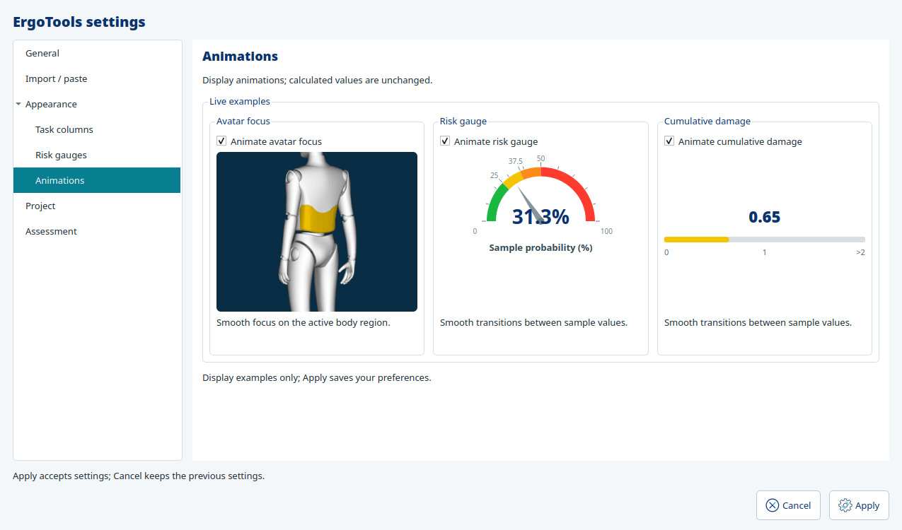
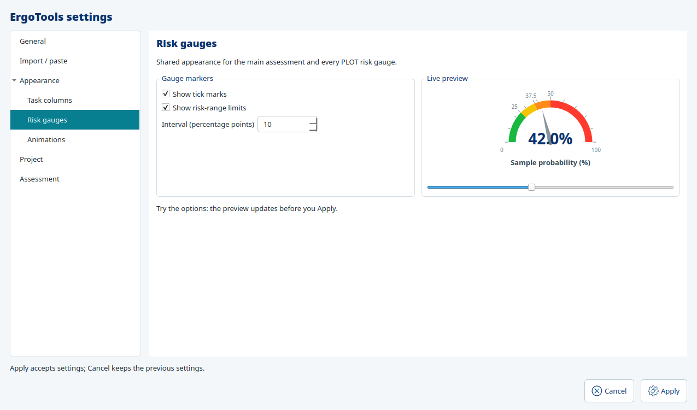

# Visual Settings and startup display diagnostics

Settings retains the existing application preferences and Apply/Cancel policy. No
project format, preference version, database, scientific formula or dependency changes.

## Settings examples

Appearance > Risk gauges shows the shared RiskGauge beside the marker controls.
Ticks, range-limit labels and spacing update the preview immediately. Its slider
changes a sample probability, without changing any assessment. The animation page's
gauge uses those same draft marker choices. Context menus cannot silently change a
preview independently of its controls.

Appearance > Animations groups three independent switches with their examples:

- Avatar focus uses a **65-frame, 280×264 GIF** recorded from the existing packaged
  anatomical meshes and unchanged VtkBodyRenderer camera paths. Enabled plays the
  recorded region-focus transitions; disabled displays the initial full-body frame,
  matching the production full-body policy. Settings creates no second VTK renderer.
- Risk gauge uses the production RiskGauge, with its actual easing and timing.
- Cumulative damage uses the production DamageScale. Sample targets change every
  2.2 seconds, so disabled animations visibly jump to the next sample instead of
  interpolating. Sample quantities illustrate presentation, not calculator outputs.

Samples stop when hidden, on page navigation, or on closing Settings. Movie/buffer/
timers are Qt-owned and discarded with the dialog. No playback event changes settings,
project data, history or calculation results. Apply saves the ordinary existing
preferences; Cancel discards drafts. Field widths are kept readable rather than
stretching every numeric control across the page. Project decimal controls show
formatted sample values immediately, including the selected decimal mark, without
rounding or modifying saved data. Navigation entries have scoped help.

The asset is derived from the already packaged model; source models/reference files
are unchanged. The derived-asset manifest records its hash and provenance. Generation
and native evidence are retained locally under artifacts/settings_display_diagnostics.
The existing pinned Pillow/VTK tools generated the recording; runtime playback uses Qt.





## Startup reporting

Reporting defaults **off on Linux**, **on on Windows and macOS**. These are launch options, not new stored preferences:

| Option | Effect |
|---|---|
| `--startup-diagnostics` | Enable for this launch |
| `--no-startup-diagnostics` | Disable for this launch, overriding platform default |
| `--diagnostics-dir PATH` | Enable and choose a report folder |

The directory option cannot be combined with explicit disable. Existing desktop
launchers forward all options and project paths, including paths containing spaces.

```bash
# Linux: enable recording for a test session
bash tools/run.sh --startup-diagnostics

# macOS: normally automatic; choose another folder if needed
bash tools/run_macos.command --diagnostics-dir "$HOME/Desktop/ErgoTools reports"
```

```powershell
# Windows: normally automatic
.\tools\run_windows.cmd

# Explicit override for one launch
.\tools\run_windows.cmd --no-startup-diagnostics
```

Default folders:

| OS | Location |
|---|---|
| Windows | `%LOCALAPPDATA%\ErgoTools\diagnostics` (AppData/Local fallback) |
| macOS | `~/Library/Logs/ErgoTools` |
| Linux | `$XDG_STATE_HOME/ergotools/diagnostics`, or `~/.local/state/ergotools/diagnostics` |

General > Display diagnostics identifies the current file and offers **Copy report
path** and **Open report folder**. The OS file browser stays independent of ErgoTools.
With reporting off, the group explains the enable option. The report path is also
printed to stderr at startup; failed startup reports can be found in the same folder.

## What to request from a tester

Ask for the current `ergotools-<UTC timestamp>-<session ID>.jsonl` file and, if present,
its `.jsonl.1` rotated sibling. For a long session these two files contain the most
recent bounded observations. The current system/Qt/screen context is repeated when
rotation has room, keeping startup metrics available alongside later messages.

JSON-lines entries include:

- OS/release/version, architecture, Python version/executable, installed application,
  Qt/VTK/solver package versions and a short explicit display-variable allowlist.
- Compiled/runtime Qt and PyQt versions before QApplication initializes its platform
  plugin, followed by the actual platform backend, style, library/plugin paths,
  high-DPI flags, rounding policy and application font.
- All Qt screens: names/model/manufacturer, logical and available/virtual geometry,
  pixel ratio, logical/physical DPI, physical millimeters, color depth and refresh rate.
- Shown/moved/resized top-level windows: geometry/frame, size hints/minima, font,
  current screen, pixel ratio, whether the frame fits that screen, and geometry/font
  metadata for at most 80 descendant controls. No control text/title is queried.
- Windows native system/window DPI, current thread DPI-awareness enum/context (including per-monitor-v2) and remote-session
  flag when those read-only APIs are available. Unavailable older APIs are explicit.
- Python logs, Qt/plugin messages and main-thread uncaught/startup exception tracebacks. Existing
  console destinations and exception behavior remain; no exception is swallowed.

The report never queries worker/task tables or copies project data. Runtime messages
and installation paths may contain local filenames. It does not dump all environment
variables, collect screenshots, query serial numbers, upload anything, create OpenGL
contexts, or change DPI awareness, Qt scaling attributes, fonts or window sizes.
Physical DPI is an OS/Qt observation, not a guaranteed hardware measurement.

Files are limited to **2 MB each with one rotated sibling**, retaining **five launches**.
Oversized messages are marked truncated. Logging I/O failures disable capture and print
one error without stopping the application. Hooks are restored at process exit; window
resize/move events are coalesced, hidden/deleted windows are skipped, and the observer
never consumes input/layout events. Reports are separate from project Save/Undo.
A native fatal exit may leave no process_end entry. Capture begins after CLI validation
with Qt imported, before its platform plugin starts; earlier interpreter/import failures
still need the console error.

## Implementation and verification boundary

`infrastructure.startup_report` owns files, logging retention and native OS readers.
`presentation.desktop.display_diagnostics` observes Qt through an injected recording
callback. Bootstrap composes both; application/domain layers remain Qt/storage-free.
`settings_previews` reuses the shared scales and a GIF, with no VTK import.

Real Linux Qt launches at 100%, 150% and 200% scaling verify reported pixel ratios and
window records. Native Windows reader calls are contract-mocked on Linux; neither
these mocks nor platform-default tests constitute native Windows/macOS acceptance.
Those OS trials remain pending, as previously agreed. Tests cover bounded Unicode
records, retention, unavailable directories, exception capture, explicit overrides,
hook restoration, live marker/animation drafts, cancellation and hidden-page cleanup.

API references: [Qt screen metrics](https://doc.qt.io/qt-6.8/qscreen.html),
[Windows DPI APIs](https://github.com/MicrosoftDocs/win32/blob/docs/desktop-src/hidpi/high-dpi-reference.md),
[Windows awareness enum query](https://learn.microsoft.com/en-us/windows/win32/api/winuser/nf-winuser-getawarenessfromdpiawarenesscontext).
The implementation uses the installed Qt 5.15 surface; no Qt 6 runtime is introduced.
