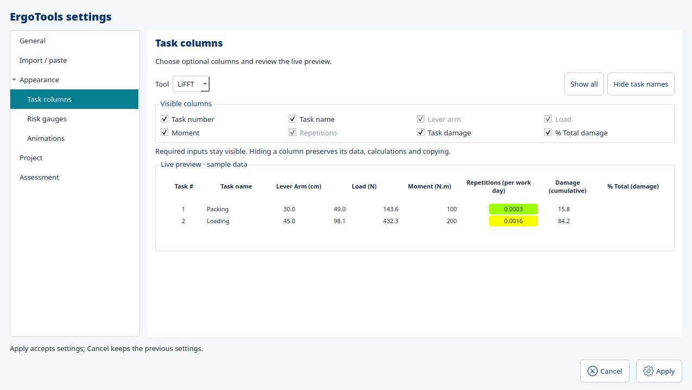

# Task column visibility

Settings → Appearance → **Task columns** offers independent LiFFT, DUET and ST views.
Select a tool, then check the columns to show. The live preview uses the actual shared
grid with temporary sample inputs and calculated outputs. Scroll horizontally to inspect
wide layouts. The larger initial Settings size shows all tool preview columns on a
suitable desktop; smaller screens retain scrolling. It never changes an assessment or saves sample data.

Required input columns are checked and locked. Optional columns are task number, task
name, moment (LiFFT/ST), task damage and percentage contribution. **Hide task names**
hides that column while retaining other choices; **Show all** restores the current tool's
optional columns. Other tools keep their independent choices.

Apply saves personal application preferences; Cancel keeps the previous view. Existing
worker, Job Management and guided JROT input grids use the same choices, including after
reopen. No task, name, identifier, measurement or calculated result is removed. Copy and
import retain their full input schema; task-copy inspectors continue showing full source
details for informed selection. Overall result totals/gauges remain visible even when
per-task output columns are hidden. Project history and Save behavior do not change.

The implementation uses stable semantic column keys, not translated labels or physical
column numbers. Only optional fields can enter `AssessmentColumns.hidden`; required
fields and unknown/repeated keys are rejected. `AssessmentEditorPreferences` explicitly
binds owned editable grids and publishes accepted visibility through Qt connections.
`AssessmentColumnSettings` uses the same `AssessmentTaskGrid` in read-only preview mode.
No global window scan, extra row renderer, calculator or separate Undo stack is added.

Personal settings format9 adds `assessment_columns`; versions1–8 default to all columns
visible and retain their other preferences. Opening old settings does not rewrite them.
The project-native schema is unchanged. For older application builds, retain matching
personal settings or choose a separate settings path.

Task-name columns now reserve135px in editable grids and105px in compact previews (25% shorter minima), with9-character input hints. Other columns receive surplus width; names no longer stretch to occupy unused space. Values and full-name tooltips remain intact. Main and Settings defaults narrow by45px.
