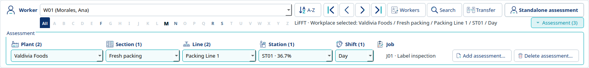

# ErgoTools User Guide

Updated: 2026-10-29.

## Start the integrated application

On this Linux development installation, run bash tools/run.sh (installed / instalado: ergotools) from the new project folder. This opens the integrated LiFFT, DUET, Shoulder Tool (ST), PLOT and JROT application with the 3D avatar. --disable-vtk is for renderer-free diagnostics only.

Use the window normally and enlarge it when needed. English and Spanish are available in Tools > Settings. Settings remains in the Tools menu; Help remains in the Help menu. Apply accepts project display decimals and units; main Save writes them to the project file; language, decimal separator and animation choices remain personal preferences. Task-count changes are local to the selected worker/tool/context and undoable.

## Projects and original-project conversion

New starts a project; Save gives an unsaved project its own .ergprj file. Open loads an existing project and an available assessment automatically, without an assessment-selection prompt. Recent projects is a shortcut to the same Open workflow. Entries display full file paths so identical filenames in different folders are distinguishable; hover retains the full literal path. Properties shows the open project metadata.

Save is disabled when the loaded project has no unsaved data and enabled when changes need saving. New projects need a first Save even when empty. Pending assessment inputs enable Save; invalid values must still be corrected before saving. Undo/Redo updates Save according to whether the restored data differs from the last Save. Save As remains available for creating a copy.

For an original XML .ergprj project, keep its database/data folder and image folder beside the descriptor with their original relative paths. Open offers Migrate/Cancel and the separate CLI command. Successful conversion opens a temporary native copy requiring first Save; it does not overwrite the original. The new project embeds plant images and recalculated native data, without an original-database or duplicate-result archive. Missing assets, conflicting records or unsupported formats stop conversion with an error instead of silently dropping records.

Save As creates and activates another project file. Backup copies persisted project data without switching the open project. Use the main Save first if the backup must include the latest accepted changes.

## Workers, organization, jobs and assessment context

A standalone assessment needs only a worker: select or create the worker, choose LiFFT, DUET or ST, enter inputs, Calculate and Save. Organization, shift and Job are optional.

Workers creates and edits worker records. Worker ID is required; optional identity, employment and body measurements are under Optional details. Add worker accepts one record and starts another. Selecting another worker or closing retains valid edits in the open project; main Save writes them. The date-of-birth calendar opens eighteen years before today when blank, without assigning a date. The Workplace assignments tab manages the worker’s workplace/shift and optional Job. Closing Worker Management never opens or creates an assessment. Use the main worker strip for surname letters and the worker selector. Ordering, navigation and worker actions are beside the selector. The Assessment button reveals the full-width browser inside the worker group, below the alphabet.

Manage organization maintains plant, section, line, station and independent shifts. Organization start/end times use standard time editors in 24-hour HH:mm format (00:00-23:59). Type 8:30 or 0830 to enter 08:30; typing 8: selects the minute section. You can also use the arrows. Not set is distinct from midnight (00:00); Ctrl+A then Delete clears an optional time. For Shifts, a same-day end must be later than its start. Select Ends the following day for an overnight shift such as 22:00-06:00. Each complete clock pair describes one daily interval of up to 24 hours; equal clocks require the following-day option for a 24-hour shift. Existing overnight pairs reopen with that option selected. The option is inferred from clock order and adds no project field. Valid changes to existing organization details, including shifts, immediately enable the shared Undo control. Clicking it accepts and reverses the pending record edit; keyboard Undo inside a text field remains local. Close or navigation accepts valid form edits into the private project; the main Save writes the file. Organization keeps Optional details open or closed and retains expanded/collapsed location branches during editing, Delete and Undo/Redo. Undo reselects a restored deleted record unless you have since selected another record. These view choices last only while the dialog is open and do not add project edits. Jobs manages Job details, workplace availability and one current LiFFT/DUET/ST risk set per Job. Enter damage directly or use Calculate or copy tool values. Referenced Jobs and placements remain protected.

The Assessment group selects the worker’s saved workplace assessment for the active tool. An existing assessment keeps its original assignment after later reassignment: the old assessment remains a historical observation, while the new assignment can have its own assessment. Saving never replaces assessments belonging to another tool or assignment.

Search opens Find Assessment across workers for the active tool. Filter by worker ID/name, surname initial or workplace, then choose Use assessment. Closing it leaves the current assessment unchanged.

## LiFFT, DUET and Shoulder Tool

Choose the tool tab and enter its task inputs. LiFFT uses lever arm, load and repetitions; DUET uses OMNI-Res and repetitions; ST adds task direction. Follow the unit labels on the controls. Results update after a completed input edit (Enter, Tab or leaving the cell) when every started row is valid and complete; unused blank rows are ignored. Started incomplete or invalid rows clear obsolete automatic totals. Calculate remains available to explicitly recalculate or review incomplete input. Main Save stores inputs/results; automatic calculation does not write the file. Each accepted input and its result share one Undo step.

Wholly unused task rows are ignored and do not make an entered assessment incomplete. Started rows with missing required values remain incomplete; those results include completed rows only. Empty or unavailable values are not proof of zero risk. Imported results appear as Recorded; saved fresh calculations retain their own status. Editing an input clears obsolete displayed results. Saved inputs and calculated results retain calculator precision. Project display defaults are one decimal for inputs, moments and probability, four for task/cumulative damage, and one for contribution percentages. Repetition counts display no decimals. Formatting and unit switches never round unchanged stored values.

Clear assessment replaces the former Reset and trash controls. After confirmation, it clears only the selected worker/tool/context inputs and calculated results, retaining task count, task identities, units and ownership. Undo restores the previous inputs/results in one step. Cancel preserves pending text; main Save writes the cleared assessment. Other workers and tools are unchanged. Use Search to find saved standalone or workplace assessments for the active tool; results include colored saved risk values. Tools > Settings > Assessment identifies the project, worker, tool and workplace (or standalone context). Select Change number of tasks on Apply and choose 1–100 (default 15). Increasing adds empty rows while keeping existing data; reducing keeps the first rows and confirms before removing entered trailing data. An unchanged count does nothing. Undo/Redo restores removed rows and their matching results; main Save writes accepted changes. Counts are independent per project/worker/tool/context. ST preserves the original selector meanings and Tab order; this migration does not change scientific formulas.

## Language, decimal marks and units

Settings supports English/Spanish, metric/imperial display and point/comma decimal input. Thousands grouping is unsupported. Existing assessment source units remain attached to their data; changing display units does not reinterpret saved numbers. Worker height/weight are displayed as cm/kg or in/lb and stored canonically as cm/kg.

CSV exports retain stable English column identifiers and point decimals regardless of interface language. Recorded unit labels and saved result precision are retained. PLOT coordinates are image pixels in either measurement system.

## Job assessments

Open **Workplace > Jobs** and select a Job or enter a new Job ID. Its name,
description and workplace assignments are on the left; the LiFFT, DUET and ST
tabs show that Job's recorded task inputs. Each tool has its own tasks. Use
**+ Task** to append a row and **- Task** to remove the selected row. Empty Job
tools show one blank starter task, independently of the main worker grid default.
Clearing or removing the final stored row returns to that starter; shared Undo
restores its source and results. Complete input edits calculate automatically; the
**Calculate** button remains available. The gauge and risk-range legend follow the
selected tool.
The grid uses the same numeric editors, descriptive selectors, column order and
sticky-header layout as the main worker tools. Colored totals sit above Clear assessment/Calculate. The right-hand groups show the
selected tool’s gauge, animated damage bar, assessment state and risk ranges. Totals
align with the Damage column; +/- Task sits between Clear assessment and Calculate.
The Job header shows the current project name. The Tasks & assessment heading also
identifies the selected Job by ID and name. Its Undo/Redo controls are slightly
larger than the other secondary windows, within the same window size. The tool tabs
use the full main-UI titles. Job selection and tool changes are reversible view actions
in the shared history and do not by themselves require Save.

**Task inputs** is the default for an empty tool. Choose **Direct result** only
when you already have a cumulative-damage value. Edit the colored damage cell beneath
the grid; its probability is derived in the next row. There is no second direct-input
form and no task inputs are recorded. Switching away from entered tasks requires confirmation.
Viewing an empty tool does not create saved data.

Use **Copy from worker…** for an existing standalone or workplace assessment,
or **Copy from Job** for the selected tool from another Job. Copies retain the inputs,
units and calculated precision and can be edited independently. Existing destination
data requires replacement confirmation. Each copy button opens a source browser with
ID/name search, surname/name initials and first/previous/next/last navigation. The worker
browser distinguishes standalone assessments from their actual workplace hierarchy,
with colored damage/probability previews. Expand the assessment or Job row to inspect its read-only task grid directly beneath
that source. The compact preview shows only rows with entered values, keeping their
original task numbers. Check the tasks you want to copy; small **All** and **None**
controls sit beside **Task #**.
All selects the populated rows. When any stored rows are omitted, a calculated
selection is recomputed on Copy so totals and contributions match the selected rows.
Copying every stored row retains the exact original result.
Uncalculated selections copy inputs without inventing results. Unused blank capacity
is not offered for copying. Source totals
remain labeled as source values while choosing rows. The alphabet fits the
associated selector width; hover enlarges the initial in place, without a floating zoom tooltip. Cancel copies nothing. Add/Delete are beside
Job details; there is no separate Discard changes action. Shared Undo/Redo restores edits, copies and
removed task rows. Close retains valid edits; use the main project Save to store them.

Secondary editors use the same adjacent icon-and-caption Undo/Redo pair as Jobs.
The main application toolbar retains its existing controls.

## PLOT: filters, layout and charts

Open PLOT from the main toolbar. Select tool, workplace, risk view and optional demographic filters, then Apply filters. The map and worker/job/tool summaries use saved assessments and approved job-risk data. Inspect Individual, Job and Comparison views, missing-data indicators and highlight details.

Open imports and accepts the plant image into the open project. Released marker gestures and valid coordinate, scale, visibility, inclusion and lock changes are retained without local Save controls. Apply to all is a validated batch edit. Closing PLOT keeps accepted changes; main Save writes image and geometry with the rest of the project. Zoom, opacity, captures and graph/CSV export retain their existing separate display/export roles.

Use CSV export for the applied saved-worker results. Summary graphs support their own settings and image export. The hidden legacy D3 experiment and unused plant transform metadata are not enabled by this migration.

Individual shows worker assessment symbols. Job shows one Job-risk square at each visible, positioned worker assignment: the same squares, sizes and positions as Comparison, without the individual symbol. Labels identify Jobs; a gray dashed square means no usable Job result. A Job can appear at several assignments. Job scope charts and the bottom Job average retain their placement-based aggregation; they are not an average of repeated map squares. Click the overview selector to search the applied workplace hierarchy, Job or worker IDs and names; choosing a leaf selects that exact assignment. Cancel retains the current selection.

Select, Zoom +, Zoom - and Pan are persistent map tools. The first rail button restores normal marker selection/movement. Magnifiers remain active across repeated clicks; Pan remains active across drags. Escape or right-click can also return to selection. There is no on-image instruction overlay. The image, worker symbols and Job squares magnify together at their original-image anchors. Wheel zoom, completed pan/middle drags, Fit image and marker opacity changes join the existing chronological Undo/Redo history. Tool choice and automatic resizing add no steps. Navigation history lasts for the open project session and does not require Save or write geometry. The plant image has no scrollbars. Maximum zoom is 400% of the fitted image. Zoom Out and Pan are disabled at fitted 100%; returning there restores the normal cursor if either tool was active. Both zoom-button tooltips show the current zoom percentage and maximum, including after Undo/Redo. Individual worker symbols have a dark outline. Locate recenters the zoomed view on the selected worker, clamping near image edges and retaining zoom. The recentering can be undone/redone without changing assignment geometry.

Job Overview includes a labeled Locate button beneath Current Job risk; it centers and highlights the selected Job square at the current zoom. The Job risk chart has one risk bar per Job, without placement-count suffixes. Squares on map in Job Overview counts the selected Job's visible repeated squares across the applied view. This count is separate from scoped Job placements and the existing placement-weighted summary. The Job record owns no map position or symbol scale; shared worker-assignment markers own them, with station anchors supplying initial positions where available.

In integrated Job view, Cancel movement restores the selected square's most recent accepted move in the current view. The restoration itself can be undone/redone. Pending typed coordinates can be discarded without replacing the accepted point. The panel reports the result; broader Undo remains available after changing views or reopening the window. Main Save writes accepted geometry changes.

## JROT: schedules and optimization

Open JROT, select or create a rotation scheme, set organization/workplace scope and fill worker/job choices for each block. Define current Job risk values through Jobs. Saved schemes retain their worker/Job arrangements and use updated current values. Changing relevant numeric values clears old optimization provenance; rerun optimization explicitly when needed.

Optimize current uses CBC for the selected tool; Optimize all uses HiGHS for LiFFT, DUET and ST together. GLPK is not used. Enter a valid limit in minutes. Review the preview/comparison and use the explicit Apply/Use as current action before Save. A solver preview alone does not replace the persisted scheme. Cancel stops an in-progress optimization without applying it.

JROT shares the chronological project Undo/Redo history. Its accepted partial grid, identity, frozen pool and scope survive closing/reopening the window. Main Save/Save As require an entered rotation to be complete or explicitly cancelled; incomplete rows are never silently omitted. Complete schemes are written with the rest of the project. Solver previews still require explicit Apply/Use as current, and replay remains disabled while a solve is running.

## Copy/Move, exports and undo

Transfer selects saved tools from a standalone or workplace source and an exact destination worker, with either Standalone assessment or a station/shift. Copy retains the source; Move removes only the selected saved assessments after the entire transfer succeeds. Both preserve exact saved task inputs, results, units and calculation status. Existing selected destination tools can be replaced after an explicit No-default warning; other tools and historical observations remain unchanged. The source itself cannot be a destination. Other assessments, Job values and owners remain unchanged.

Copy/Move uses accepted project inputs and exact matching results, including unsaved project-session edits. Invalid, unaccepted field text is not copied. Transfer still requires its explicit record-operation confirmation, but never a separate project Save. Main Save publishes the resulting records together. CSV export reads accepted open-project data without saving it.

Main and editor Undo/Redo use the same chronological project history. One worker addition or accepted edit is one step; closing its window is not a step. Replay that removes records identifies them and requires confirmation, with Cancel as default. Cancellation consumes no step. Restoration and ordinary field/navigation changes need no removal warning. An existing worker’s valid pending edit enables the title-row Undo without closing the window. Clicking it reverses that edit; Redo reapplies it. Focused fields keep typing Undo. Save preserves history; closing/switching projects ends it.

## Backup, recovery and limitations

Before recovery, keep a separate copy of the current .ergprj file. Open a backup under a different name and check worker/context, all three tool results, PLOT image/markers and JROT schemes before continuing. Save As can make this verified backup your working copy. Format-14 projects contain their images/native results; original XML projects still require their original sidecars until conversion.

A failed Save retains the draft for correction or retry. Do not assume an error committed data; reopen a separate backup to inspect persisted state. Backups exclude unsaved edits and Undo histories. If Open/conversion fails, retain the originals and the error details; do not edit database rows blindly to bypass validation.

This release is validated on Linux XCB with approved exact dependency versions. Windows/macOS native acceptance is deferred. The scientific calculations preserve the original behavior, including documented metric moment and ST direction conventions; this migration is not a scientific revalidation. Hidden anthropometry prototypes remain only in the external original reference;
they are not packaged as validated tools or archived inside native projects.

## Open a project from the command line

The original positional-project convention is supported:

```bash
bash tools/run.sh "test_projects/native/comparative_risk_test.ergprj"
```

From an independent installation, use `ergotools "/absolute/path/project.ergprj"`.
Quote paths containing spaces. Relative paths are relative to the terminal's
current directory, even when the launcher script lives elsewhere. The normal
original-project conversion dialogs still apply; native projects select available assessments automatically;
startup does not automatically Save. Successful opens enter Project > Recent
projects (Proyecto > Proyectos recientes), up to ten paths, newest first.
Cancelled or failed opens are not added. Clear History removes only menu history.

The current comprehensive fixture contains assessments, PLOT and JROT data.
Use Save As for a personal review copy; the fixture needs no companion folders.
`test_projects/native/integrated_test.ergprj` is the second converted dataset.
Earlier M10 artifact files are historical checkpoints, not current fixtures.

## Analysis selections and shared project history

The main Edit menu/toolbar and editor title-row buttons use the same project
Undo/Redo. Platform shortcuts remain available (verified Linux desktop: Ctrl+Z
and Ctrl+Shift+Z). Focused text editors retain native typing history, including
when it is empty. Worker, organization, Job, PLOT and JROT windows replay the
shared project chronology. Task-grid rebuilds do not retain deleted input widgets.

PLOT marker edits and analysis configuration join that same project history.
Apply records the accepted demographic setup, including its enabled flag, sex and
all canonical bounds. Disabled, unpaired and reversed bounds are retained exactly
even when they do not constrain the effective dataset. Tool selection, accepted
workplace selection, Clear and immediate risk-mode Apply are also reversible.
Tool selection still requires Apply to update results, preserving the existing
workflow. Undo restores both the selected controls and the applied dataset.
Replay restores accepted filters, native geometry and embedded scope images.
Rejected restoration leaves the history cursor unchanged. Analysis-only choices
do not require project Save; accepted geometry/image edits do. Closing PLOT retains
accepted content privately without writing the file.

JROT history includes the displayed risk tool, All Jobs/workplace selection mode,
accepted pending workplace selections, applied scope/frozen pool, grid and applied
optimization provenance. Accepting the scope chooser and subsequently pressing
Apply are separate steps. Cancelled selection adds none. Undo of pending choices
does not rebuild them from current database records or change the applied pool.
Existing solver ownership disables replay until the owned solve finishes.

History supports multiple steps with no configured count limit, while the editing
session exists. A new accepted edit after Undo clears Redo; no-ops and rejected
operations retain it. Save is explicit and does not add a history entry. History
survives editor closure, reopening and JROT scheme navigation/New/Cancel, until
the project closes or switches. Accepted deletions, transfers and management edits
are reversible; external file creation/export effects are not rolled back.
See [single project Save](single_project_save.md) for removal confirmations and
the durable Save/Discard/Cancel boundary.

Cleanup M1 separates old-project conversion into the removable
`tools/project_migration` utility. See its README and
M1 acceptance. The current installed wheel excludes
conversion code. Guided migration and separate original/native fixture organization
are accepted in M2; comprehensive per-symbol documentation completion is M4. All six cleanup milestones are now accepted for Linux; owner acceptance testing
can use the current native fixtures and final delivery package.

M1R supersedes M1's result policy: external conversion recalculates saved inputs;
native storage keeps one result per assessment with calculator precision.
UI formatting/gauge limits do not round stored values. The regenerated comprehensive
projects are in `test_projects/native`; see its README and cleanup_m1r_acceptance.md.
Historical artifacts/guides describe their earlier checkpoints and are not current
test datasets. M1/M1R/M2/M3/M4/M5 are accepted. Final inventory, package hashes and Linux
validation are recorded in cleanup_m5_acceptance.md and cleanup_m5_validation.json.

## Guided original-project upgrade — cleanup M2

Opening an earlier project explains why it needs an upgrade and offers **Migrate**
or **Cancel** (English/Spanish). It also shows a copyable command for the separate
utility. Migrate runs that external process; no converter code enters the app.
Keep original database/image folders together until conversion succeeds. Missing
tools/assets, unsupported schemas or invalid data leave the current workspace open
and show the tool error. Cancel does not start conversion. No automatic retry.

The converted project opens in temporary native storage. Use the main **Save**
action, choose a new `.ergprj` file and confirm the prefilled project details.
Original date/language/default units are retained; current display units/language
do not reinterpret task data. Cancelled/failed first Save keeps the temporary copy
open for retry. Closing/switching asks Save/Discard/Cancel even when its current
assessment is clean. Discard removes the temporary copy. An application/system
crash before first Save can lose that temporary copy; the original remains intact.

Temporary files never enter Recent Projects. After first Save, only the permanent
native file is needed: it embeds every plant image and all supported data, including
PLOT/JROT relationships. The ordinary New-project pre-save restrictions are reused;
Save first before management/PLOT/JROT/export. During this temporary stage the
existing New-project header says no project loaded; the bottom message explicitly
identifies the upgraded copy and requests Save. No unrelated header redesign.

For command-line conversion instead of the GUI:

```sh
.venv/bin/python tools/project_migration/migrate_project.py "/path/original.ergprj" --output "/path/new_project.ergprj"
```

The CLI publishes directly to its explicit new destination. For installed-wheel
users, retain the separately supplied `tools/project_migration` folder and invoke
its script with the approved environment, or expose an `ergotools-migrate` wrapper
on PATH forwarding the same arguments. The app detects that optional command;
without a tool it still opens all current native projects. Do not reinstall or
upgrade dependencies to run the converter. See its README for supported formats.

Current fixtures: `test_projects/native/comparative_risk_test.ergprj` and
`test_projects/native/integrated_test.ergprj`. Originals and sidecars are separate
byte-identical reference copies in `test_projects/originals`. The two other original
samples still have documented schema/metadata limitations; no repair was added.
Cleanup M4/M5 are complete; the native fixtures are ready for owner testing.

## Assessment context navigation

The worker selector, ordering, first/previous/next/last, Workers, Search and Transfer share the top worker row; surname letters remain beneath the selector. Standalone assessment and the current-selection summary are inside this worker area. Assessment reveals a compact full-width group beneath the alphabet, inside the same frame. Standalone is at the right of the worker selector row; the Assessment disclosure is beneath it, beside the single-line selection summary. The alphabet sits tightly beneath the worker selector. Explicit toggles animate without moving/rebuilding the alphabet or status row; initial project restoration settles immediately. It starts hidden when no visibility choice has been saved; main Save retains an explicit expanded/collapsed choice. Worker navigation opens the active tool’s standalone assessment first. If none exists, it opens the first saved workplace assessment alphabetically by Plant, Section, Line, Station and Shift; if no source exists, it shows a clearly labeled standalone preview without creating data. Plant, Section, Line, Station and Shift list only this worker’s saved assessments for the active tool and cascade to relevant choices. Counts belong to headings, not saved names. Station shows the selected risk percentage and shared risk colors; other stations with varying results show a range, never an invented mean. Shift contains only its identity. Job has a separate information cell, becoming a selector only when multiple saved owners share a station and shift. A subtle outline marks the open workplace path or the Standalone button; the summary identifies the selection even while context is hidden. Available workplace assessments remain advertised when standalone is open. The location dropdowns select existing data; the separate Add/Delete actions manage assessments. They do not assign Jobs or copy data. Transfer remains the explicit Copy/Move workflow.

The Assessment disclosure aligns with the worker area's right edge, leaving the selection summary the remaining width. Place and Job names receive more space; Shift uses a compact width that adapts to its identifiers. The Job value aligns with the text after its heading icon. During reveal/collapse the unchanged upper controls use a temporary display buffer to avoid repaint flicker; input and focus still belong to the original controls. A worker/tool/language change or window resize immediately restores live painting. No image or UI snapshot is saved to the project.

Use **Add assessment…** at the right of the expanded Assessment group to choose a
station and shift in the shared workplace hierarchy picker. The tree marks saved assessments with their risk percentage and shared colors,
including on the selected row. Uncalculated saved assessments, New stations and
Historical-only evidence have distinct labels. These states follow the selected Shift
and current tool; historical observations remain protected. A Job is optional. The
current worker and tool are fixed by the main controls. An existing active workplace
assignment is reused with its Job unchanged; otherwise the assignment is created
with the blank assessment. If that assignment already has this tool's assessment,
ErgoTools asks before replacing its task inputs/results; No is the default and keeps
them intact. Yes opens a blank 15-task grid while retaining the assessment identity.
New blank assessments can be saved empty and completed later. Main Save writes the
project; shared Undo/Redo restores creation or replacement, including prior results.
Standalone assessments and other tools are independent and remain unchanged.


The context picker identifies the worker and active tool and shows real workplace assignments as Saved or Not created, with the exact plant, section, line, station and shift. Open assessment opens the existing source. Create assessment explicitly creates one blank assessment for the selected assignment/tool in the open project; main Save writes it to disk. Cancel creates nothing. Creating another assessment for the same worker, tool and Job at a different workplace requires confirmation listing existing locations. Other Jobs and tools do not trigger that warning. Standalone assessment returns to independent worker/tool data. Workplace assignment alone never moves or copies data. Use Transfer for the explicit Copy or Move choice.

Switching tools, workers and assessment contexts retains accepted input and project history without a local Save prompt. Main Save/Save As include accepted edits from all editors. Only leaving the project asks Save/Discard/Cancel. Invalid unfinished numeric input must be corrected or cancelled before accepting that form. Last-used locations remain personal settings; context visibility is a project display preference.

The avatar colors every available tool region for the selected worker and exact Job assignment/context. The sidebar and camera focus follow the active tool.


Undo and Redo are the first two main-toolbar actions. PLOT and JROT have Undo/Redo buttons at the far right of their main title row, with the same shortcuts and editing history. Their separate Edit menu and history bar have been removed. Click a colored avatar region to select LiFFT (lower back), DUET (forearms/hands) or ST (shoulders). Neutral anatomy and background do nothing; dragging still rotates the avatar. Tool selection retains context and edits and uses the existing camera animation preference.


The main toolbar is titled **Project** and groups Undo/Redo, New/Open/Save, PLOT/JROT, and Organization/Jobs. Export is available in Project; Workplace contains Organization and Jobs. Project dialogs offer only .ergprj; an arbitrary SQLite database is not a valid ErgoTools project. Properties shows saved project details and is unavailable before the project is saved.

Assessment Undo/Redo now includes accepted tool, worker and workplace/context navigation, interleaved with source edits. Each completed numeric field and each DUET rating or ST task-type selection is a separate reversible edit. Leave a field or press Enter to complete it. Invalid unfinished numeric input remains visible and must be corrected before project replay; other valid cells can complete independently. Focused text fields keep their own typing Undo. Navigation history lasts for the open project session and is cleared on project close/switch; a new operation discards the superseded redo branch. Worker/context departure still resolves Save/Discard/Cancel, ending that scope's source-edit history: navigation Undo restores the view but never undoes a Save, resurrects discarded edits or recreates deleted data. Cancellation leaves the navigation history step available.


Project Properties now shows only applicable single-file details: project name, filename, full location, recorded creation date/time, project language and measurement system, plus a complete scrollable description. Values are read-only and copyable; the dialog can be enlarged. Unknown optional metadata says Not recorded. Obsolete database/image/data sidecar folders are no longer displayed.

Assessment source Undo/Redo restores the horizontal and vertical scroll position captured when the edit began. For long grids, changing task 1 and undoing stays at task 1; edits in the middle return to that location even if you scroll away before replay. Qt focus is cleared from retiring controls before grid replacement, and scroll ranges update with row-count changes. This presentation state is session-local and never saved as scientific data.


Worker assignment Change and Remove retain historical assessment ownership. Add, Change and Remove accept valid worker/dropdown edits into the project session before operating; no local Save is required. Classification remains restricted to Jobs placed at the exact workplace and shift, and occupied destinations are rejected. Main Save writes these accepted changes. Workplaces counts station/shift placements, not Sections.


Assessment version creation and current-version selection have been removed. The Project menu retains New assessment and Assessment context. Each worker Job assignment and ergonomic tool has at most one saved assessment; Save updates that assessment. There are no New blank version or Set current version actions. Reassignment to another Job is a different assignment, not a second assessment version. Existing real task inputs/results remain linked to their original assignment.

Current format-19 test projects are test_projects/native/comparative_risk_test.ergprj and test_projects/native/integrated_test.ergprj. The standard test files have been updated in place to format 19 and open directly without conversion. Opening an earlier full native project offers the existing external migration workflow and creates a separate format-19 file. The converter removes only a verified empty duplicate LiFFT draft without entered task values or a result; conflicting populated duplicates stop conversion for a specific data decision. It never silently chooses which real assessment to discard.

Standalone worker assessments need no organization or Job. Use Transfer to choose Copy or Move for selected assessment tools. Both standalone sources and workplace sources are supported. Choose the destination worker, station and shift in the existing dialog. Copy retains the source and creates independently editable data; Move removes the selected source only after the destination is created successfully. Existing destination assessments are protected. Tasks, units and matching calculated results retain their exact values. The operation is atomic and uses shared Undo/Redo; main Save publishes accepted changes. There is no separate Copy to workplaces command.


## Assessment gauge markers

The main assessment and all PLOT risk gauges share optional tick marks and risk-range labels (0, 25, 37.5, 50 and 100). Right-click any gauge to change their visibility or spacing immediately, or use Tools > Settings > Appearance > Risk gauges and Apply. Settings has a section tree for General, Appearance, Project and Assessment; switching sections retains pending choices. The default interval is 10 percentage points; presets include 5, 20 and 25, and custom intervals accept 1–100. Turn off both visibility options to restore the plain gauge. These personal preferences are saved across restarts and do not change calculations or project data. Cancel in Settings keeps the current appearance. ErgoTools forms and input prompts use the application theme; file, color and font selectors retain the platform default appearance.


## One project Save — Guardado único

One main Save writes the entire project: workers, organization, Jobs, assignments, assessments, PLOT and complete JROT schemes. Closing an editor retains accepted changes without writing the project file. Project close or switching offers Save/Discard/Cancel. Main and editor Undo/Redo buttons share one chronological history. Use Tools > Settings > General > Undo steps to choose the shared project Undo/Redo budget (default 25, minimum 1, maximum 50). This personal setting applies across projects and is remembered after restarting. Apply changes the open session immediately; Cancel keeps the previous limit. Lowering it discards older Undo steps and may shorten Redo, without changing current project data. Increasing the limit cannot recover discarded steps. Removing records through replay requires confirmation; restoring records, ordinary edits and navigation do not. Text fields keep native typing Undo. Save keeps Undo/Redo; retained history lasts until the project session ends.

Un único Guardar principal escribe todo el proyecto: trabajadores, organización, trabajos, asignaciones, evaluaciones, PLOT y rotaciones JROT completas. Cerrar un editor conserva los cambios aceptados sin escribir el archivo. Al cerrar o cambiar el proyecto se ofrece Guardar/Descartar/Cancelar. Deshacer/Rehacer comparte un historial cronológico entre ventanas. Quitar registros mediante el historial requiere confirmación; restaurar registros, editar valores y navegar no. Los campos conservan Deshacer de escritura. Guardar conserva el historial hasta finalizar la sesión del proyecto.

See [workflow, architecture and acceptance](single_project_save.md).


Task-input history contract (2026-10-18, superseding pending-grid grouping): valid
LiFFT/DUET/ST edits expose main Undo immediately. Each numeric input completes on
focus departure or Enter; a rating/direction choice completes immediately. Each
completed cell is one command on the existing shared project cursor, without widget
rebuild, calculation or Save. Acceptance selects only that cell; another unfinished
or invalid widget is never swept into its command. Invalid text stays local and
blocks global replay until corrected, while valid siblings can complete separately.
The last still-focused valid input completes before mouse toolbar replay. Undo and
Redo therefore restore one completed input at a time and recover the exact matching
result when returning to its source. Focused Ctrl+Z remains native typing Undo, no-op
completion adds no history and only main Save publishes data. Explicit bulk commands
retain their atomic boundary. See task_cell_history_acceptance.md for evidence.


Use **Project > Open project folder** (**Proyecto > Abrir carpeta del proyecto**)
to find the saved project file in your system file manager. Its window remains
independent when ErgoTools closes. The action is available only with a saved project
loaded; save a new or converted unsaved project first. It does not save the project.
Leaving a task field still completes that field under the shared history rules. Repeated task edits, Undo and Redo now refresh the grid on
every reversal, including returning to the same original inputs multiple times.

Shifts describe recurring schedules, not particular dates. Incidents reported and
Ergonomic risk events are no longer fields in the form or native storage. Format 17
conversion removes those obsolete Shift attributes; exact task inputs, results and
other project data are retained. Earlier native files use the existing external
conversion workflow; current maintained test projects were updated in place.

Organization opening/creation dates now use optional calendars (empty popups start
at today; Ctrl+A/Delete clears). Plant operational duration uses hours/minutes,
0–24 hours including a full day, stored as decimal hours. The read-only Shifts in use
count derives from distinct active Jobs or worker workplace assignments in each
Plant, including unclassified workers; unused project shifts do not count and no
redundant count is stored. Obsolete Station task description, equipment, risk level,
performance metric, power and materials fields were removed from storage/forms.


## Workplace assignments and assessment association

Workplace assignments are separate from assessment association. In Worker Management, open Workplace assignments and choose Assign workplace…. Select a station in the hierarchy, a Shift, then an optional Job. No Job is valid; the summary counts workplace assignments and those with a Job separately. Change uses the same picker and retains historical assessment owners. Use Transfer to choose Copy or Move for selected assessment tools. Both standalone sources and workplace sources are supported. Choose the destination worker, station and shift in the existing dialog. Copy retains the source and creates independently editable data; Move removes the selected source only after the destination is created successfully. Existing destination assessments are protected. Tasks, units and matching calculated results retain their exact values. The operation is atomic and uses shared Undo/Redo; main Save publishes accepted changes. There is no separate Copy to workplaces command.

Las asignaciones de lugares de trabajo son distintas de la asociación de evaluaciones. En Gestión de trabajadores, abra Lugares de trabajo y elija Asignar lugar…. Seleccione una estación en la jerarquía, un turno y un trabajo opcional. Sin trabajo es válido; el resumen cuenta por separado las asignaciones y las que tienen trabajo. Cambiar utiliza el mismo selector y conserva los propietarios históricos de evaluaciones. Para asociar una evaluación independiente guardada, use Asociar evaluación en la ventana principal. Seleccione directamente el lugar y turno: se reutiliza una asignación existente sin cambiar su trabajo o se crea la asignación que falta al aceptar. La creación y asociación forman una operación atómica y un solo paso de Deshacer/Rehacer compartido. Cancelar no crea asignaciones. Los datos, resultados y otras herramientas no cambian. Use Guardar en la ventana principal para escribir los cambios aceptados en el archivo del proyecto.


## Workplace table readability

The Workplace assignments table sizes each location column to its full values and header. The optional Job column fits its available choices, including the dropdown arrow and padding, and keeps a useful default width when empty. Horizontal and vertical scrollbars appear only when the columns or rows exceed the available space. Long values remain on one line; narrow Station or Shift columns do not expand just because a Plant name is long.

La tabla Lugares de trabajo ajusta cada columna de ubicación a sus valores completos y encabezado. La columna de trabajo opcional se ajusta a sus opciones, incluida la flecha y los márgenes del selector, y mantiene un ancho útil cuando está vacía. Las barras de desplazamiento horizontal y vertical aparecen solo cuando las columnas o filas superan el espacio disponible. Los valores largos permanecen en una línea; las columnas de estación o turno no se ensanchan solo porque el nombre de una planta sea largo.


## Workplace table fill, action borders and hover help

When the workplace columns fit, the optional Job column uses the remaining table width and its selectors fill that space. Resizing the window recalculates the layout; long values retain their readable widths and use horizontal scrolling when needed. Row height and Actions width include the controls and cell padding so both button borders remain visible. Hover a value for its column and full text, a header for its meaning, the Job selector for its current choice and optional-Job help, or an action for that operation. Empty grid space has no generic Job tooltip.

Cuando caben las columnas del lugar de trabajo, la columna de trabajo opcional utiliza el ancho restante y sus selectores ocupan ese espacio. Al cambiar el tamaño de la ventana se recalcula la distribución; los valores largos conservan un ancho legible y usan desplazamiento horizontal cuando hace falta. La altura de fila y el ancho de Acciones incluyen los controles y márgenes para mostrar completos los bordes de ambos botones. Al pasar el puntero sobre un valor se muestra su columna y texto completo; sobre un encabezado, su significado; sobre el selector de trabajo, la opción actual y su ayuda; y sobre una acción, su operación. El espacio vacío no muestra una ayuda genérica de trabajo.


## Job values, task calculators and worker copies

Each Job has one independent current value set for LiFFT, DUET and ST. Direct damage entry derives probability. Expand Calculate or copy tool values, select a tool and choose Task calculation for a compact grid without the avatar. Start with one task; + adds a row up to 100 and - removes the selected row. Calculate retains exact task moments, damage, contributions and totals. Editing inputs clears stale outputs until Calculate; Clear tool affects only the selected tool and requires confirmation. Use worker assessment selects a standalone or assigned assessment of that tool and copies its exact task inputs and matching calculated outputs without recalculation, assignment or a live link. Later worker and Job changes are independent. Replacement or removal of stored tasks requires confirmation. Close accepts valid edits privately; the main Save writes the complete project. The Job window uses the same Undo/Redo history as the main window, with one accepted input change per step. Incomplete Job inputs survive Save/reopen and remain unavailable to PLOT/JROT until complete. Completed Job task edits calculate automatically using the same tools as worker assessments, without changing source units or task order. Calculate can verify the same values explicitly.


All three maintained files—workflow_4_workers.ergprj, comparative_risk_test.ergprj and integrated_test.ergprj—remain at their established test_projects/native paths and use format 19. External conversion retains selected older Job values, removes obsolete profiles/evidence, and preserves worker inputs/results and schedule arrangements.

## Display animations

Tools > Settings > Appearance > Animations groups avatar focus, risk-gauge animation
and cumulative-damage animation. The three personal choices persist across restarts;
they do not belong to a project or change calculations. Disabling a result animation
immediately shows its current target. Main, Job and PLOT result widgets use these
preferences when opened. Cancel leaves the previous choices unchanged.


## Finding, deleting and resizing worker assessments

**Search** finds saved assessments for the active tool, including standalone and
historical workplace observations. Filter by worker ID/name, surname initial or a
saved workplace branch; choose a row to open its exact assessment. Saved risk
percentages keep their colors when selected; Not calculated indicates existing
inputs without a saved result.

**Delete assessment…**, beside Add in the expanded Assessment group, lists only
the selected worker's saved assessments for the active tool. Select one, then
confirm removal. Its tasks and results are deleted; the worker, Job and workplace
assignment remain. Location dropdowns update immediately. Undo restores the exact
source and results; main Save makes the deletion durable. Cancel/No changes nothing.
Clear assessment is different: it empties inputs while retaining the assessment
and its task rows.

**+ Task / - Task** between Clear assessment and Calculate append one blank row or
remove the last row of the active tool. Counts stay between 1 and 100. Removing a
row with inputs requires confirmation; Undo restores its data/results. New rows
are revealed for entry. Other workers, tools and contexts are unchanged. The
Assessment settings page still supports setting a larger count in one operation.

**Transfer** shows the source tools' saved percentages and a separate colored
column for each available tool at destination stations and on the first Standalone
assessment row. Destination values follow the selected worker; station values also
follow the selected shift. Existing uncalculated assessments are marked
explicitly. Select Standalone assessment to create missing selected tools without a
workplace or shift, for the same worker or another worker. Existing selected tools
are marked for replacement and require explicit confirmation; No changes nothing.
A dash means that destination has no assessment for that tool. The identical source
owner cannot be selected as a transfer target. All selected tools transfer atomically;
Undo restores replaced data and Move sources together. A successful Move of the shown
assessment opens its new destination; Copy keeps the source in view. Main Save writes
accepted transfers. Find lists Standalone assessments first, then All workplaces.


## Assessment navigation examples



The hierarchy selectors identify the selected worker/tool assessment. Find searches
saved sources; Transfer creates or replaces independent data at another owner.

[Find Assessment](images/find_assessment.png) · [Transfer Assessment](images/transfer_assessment.png)
· [Worker workplace assignments](images/worker_assignments.png).
